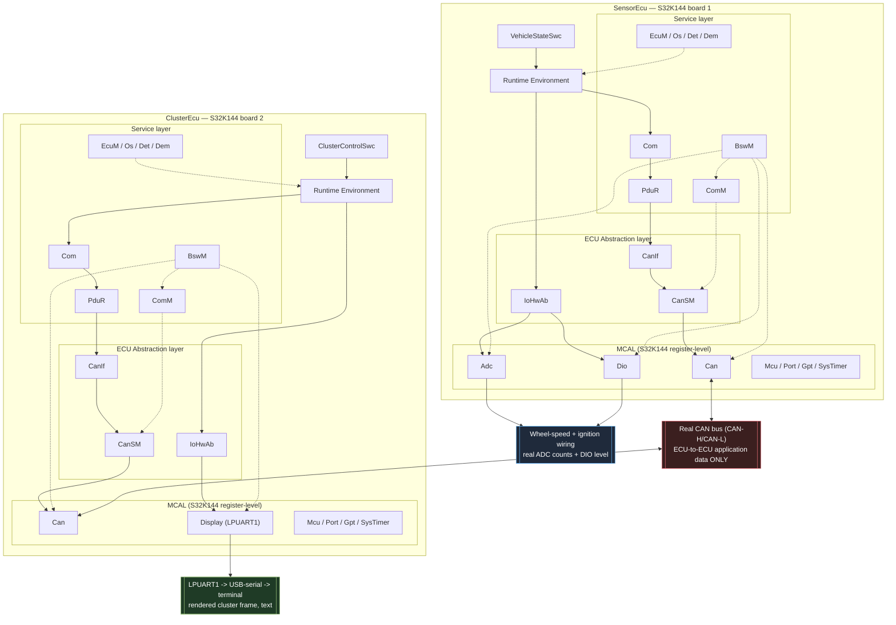

# AUTOSAR Classic - Architecture and Implementation Specification (v3.0)

## 0. Document control

| Field | Value |
|---|---|
| Project | Simplified AUTOSAR Classic Vehicle Speed Monitor |
| Document role | Architecture, implementation contract, and acceptance criteria |
| Target platform | Two physical NXP S32K144 (Arm Cortex-M4F) boards, bare-metal, no RTOS |
| Runtime | Two ECU firmware images, one per board, communicating over a real CAN bus |
| Architectural emphasis | Complete Classic Platform vertical stack in both directions: ASW / RTE / Service (incl. BSW mode management) / ECU Abstraction / MCAL |
| Intended reader | Developer building and flashing the two boards |
| Language | English specification; AUTOSAR identifiers retained |
| Status | v3.0 — hardware-only; supersedes the Ubuntu-simulation spec for this tree |

### 0.1 Important qualification

This project is an educational, AUTOSAR-inspired implementation. It reproduces the main architectural boundaries, data flow, naming style, static configuration approach, and development discipline of AUTOSAR Classic Platform. It does **not** claim AUTOSAR conformance, replace a licensed BSW stack, or pretend that hand-written configuration is schema-compliant ARXML. This qualification is unchanged from v1.0-v2.0 and stays true of v3.0.

### 0.2 What v3.0 is, and where the rest of the system's history lives

Versions v1.0 through v2.0 of this project (see `legacy-sim/AUTOSAR_CLASSIC_PROJECT_SPEC_v1.1.md`, preserved verbatim) targeted **Ubuntu as a simulation host**: two processes on one Linux machine, talking over `vcan0` and `AF_UNIX` "virtual hardware links" driven by a Tkinter HMI, with a full unit/integration test suite (26 tests) verifying every layer.

**v3.0 removes that simulation entirely from this tree.** The main tree now builds only real S32K144 firmware for two physical boards, wired to a real CAN bus and (on `SensorEcu`) real ADC/DIO signals. This is a one-way pivot, not an additive phase:

- Everything Ubuntu-specific (`VirtualHw`, the Tkinter HMI, the scenario player, `vcan0` tooling, and the full unit/integration test suite) has moved to `legacy-sim/`, a frozen, standalone copy of the project exactly as it worked before this pivot — its own `CMakeLists.txt`, its own spec, still buildable and testable on Ubuntu on its own.
- This tree has **no automated tests**. Verification is by flashing real hardware and observing real behavior (section 14). This is a deliberate, accepted tradeoff, not an oversight — see section 14 for why and what replaces it.
- Everything that was never host-specific — the application SW-Cs, the RTE contract, the CAN PDU/signal/CRC design, the communication stack behavior, the scheduling model, DET/DEM, and the BswM/ComM/CanSM mode-management split introduced in v2.0 — carries forward **unchanged in substance**. Sections 4-8 and 10 of this document summarize that unchanged content and point at `legacy-sim/`'s copy of the same sections for the full detail, rather than duplicating 1000+ lines that would only drift out of sync.

### 0.3 Change log (summary; full v1.0-v2.0 history is in the legacy spec)

| Version | Change |
|---|---|
| v1.0-v1.2 | Ubuntu two-process simulation baseline: communication stack, virtual hardware links, SysTimer/Os_Counter split. See legacy spec. |
| v2.0 | Added `BswM`/`ComM`/`CanSM` (real AUTOSAR mode-management module split, replacing `EcuM`'s inlined driver-lifecycle/comm-mode decisions) and a first register-level MCAL port for the S32K144, built alongside the Ubuntu simulation via a CMake variant switch. |
| **v3.0** | **Hardware-only pivot.** Removed the Ubuntu MCAL (`Mcu.c`, `Port.c`, `Gpt.c`, `SysTimer.c`, `Adc.c`, `Dio.c`, `Can.c`, `Can_Stub.c`), `VirtualHw` entirely, the Tkinter HMI, the scenario player, and the whole unit/integration test suite from the main tree (preserved in `legacy-sim/`). Added `Display_S32K144.c` (LPUART1 text output — `ClusterEcu` had no real display driver before this). Authored `ecu/ClusterEcu/main.c` (bare-metal entry point; only `SensorEcu` had one before). Removed the `VirtualHw_ConfigType`/`VirtualHw_Init`/`VirtualHw_DeInit` dependency from `EcuM`/`BswM` (real hardware has no "virtual hardware link" to initialize). Simplified `CMakeLists.txt` to a single fixed S32K144 source list (no more `AUTOSAR_MCAL_VARIANT` switch — there is only one variant now) with a `.hex`/`.bin` post-build step. |

---

## 1. Goal and scope

### 1.1 Goal

Build a demonstrable two-ECU system on real NXP S32K144 hardware in which:

- `SensorEcu` (board 1) reads a wheel-speed sensor through a real ADC channel and an ignition line through a real GPIO/DIO channel.
- `SensorEcu` acquires those inputs through the full input path `Adc/Dio (MCAL) -> IoHwAb (ECU Abstraction) -> RTE -> SW-C`, unchanged from v1.
- `SensorEcu` publishes `VehicleStatus` on a real CAN bus every 20 ms.
- `ClusterEcu` (board 2) receives and validates the data over the same real CAN bus, calculates the cluster state, and publishes `ClusterStatus` every 100 ms.
- `ClusterEcu` drives a real LPUART1 text output through the full output path `SW-C -> RTE -> IoHwAb -> Display (MCAL) -> UART`, viewable in any serial terminal.
- Both communication directions traverse the complete simplified Classic Platform path: `SW-C -> RTE -> COM -> PduR -> CanIf -> CanSM -> Can -> real CAN bus`.
- Periodic runnable activation, ECU initialization (via `EcuM`/`BswM`), error reporting, timeout supervision, mode management (`ComM`/`CanSM`), and static configuration are all visible in code, exactly as in v1.0-v2.0.

The teaching goal is unchanged: a reader can point at any line of application code and answer which layer owns it, which layer is allowed to call it, and what would have to change to move to different silicon. Under this design the answer to the third question is always "only the MCAL" — and as of v3.0, that claim has actually been exercised once, for real, rather than only simulated.

### 1.2 In scope

- Application Software Components (SW-Cs) — unchanged from v1, see section 4
- Generated-style RTE APIs and buffers — unchanged, see section 5
- Simplified `Com`, `PduR`, `CanIf`, `CanSM`, and `Can` modules — unchanged behavior, real transport
- Simplified `EcuM`, `BswM`, `ComM`, `Os`, `Det`, and `Dem`
- Register-level MCAL for the S32K144: `Mcu`, `Port`, `Gpt`/`SysTimer`, `Adc`, `Dio`, `Can`, `Display` (LPUART1)
- `IoHwAb` ECU Abstraction: raw-to-physical conversion, plausibility, and signal validity — unchanged
- Real wiring: a wheel-speed sensor (or bench signal source) into `SensorEcu`'s ADC pin, an ignition switch/signal into its DIO pin, a real CAN bus (CAN-H/CAN-L + termination) between the two boards, and a USB-serial connection to `ClusterEcu`'s LPUART1 for display
- Classic CAN, 11-bit identifier, 8-byte payload
- Static configuration in `*_Cfg.c` and `*_Cfg.h` (no command-line configuration on this target — see section 11)
- Hardware bring-up verification (section 14) in place of unit/integration tests

### 1.3 Out of scope for v3.0

- Full AUTOSAR specification conformance (unchanged from v1)
- Vendor BSW, real RTE/BSW generators, or production ARXML toolchains
- UDS/DCM, NvM, bootloader, cryptographic stack, SecOC, Nm bus-sleep/wake coordination
- CAN TP, large diagnostic payloads, CAN FD, LIN, FlexRay, or Ethernet
- Multi-core OS, memory protection, timing protection, MPU, or ASIL certification
- Production E2E Profile implementation
- Any silicon other than the S32K144
- **Automated testing of any kind in this tree** — see section 14 for the replacement verification method and why this tradeoff was accepted
- The Ubuntu simulation itself — frozen in `legacy-sim/`, not part of this tree's build or scope going forward

---

## 2. System context

Two independent S32K144 boards, each running one bare-metal firmware image (`sensor_ecu` or `cluster_ecu`), power-cycled independently. They share exactly one channel: a real two-wire CAN bus (CAN-H/CAN-L, with termination resistors at both physical ends of the bus per standard CAN wiring practice). Unlike the v1-v2.0 Ubuntu simulation, there are no other shared channels (no shared filesystem, no shared clock, no virtual hardware link) — the two boards are as physically separate as two ECUs in a real vehicle.

| Channel | Carries | Endpoints |
|---|---|---|
| CAN bus (CAN-H/CAN-L) | `VehicleStatus` (`0x180`), `ClusterStatus` (`0x181`) — application data ONLY | `SensorEcu`'s FlexCAN0 <-> `ClusterEcu`'s FlexCAN0 |
| ADC0 analog input pin | Wheel-speed sensor signal (or bench voltage source), raw counts | External signal -> `SensorEcu` only |
| DIO/GPIO input pin | Ignition line level | External signal -> `SensorEcu` only |
| LPUART1 (USB-serial) | Rendered cluster state, as text | `ClusterEcu` -> a PC serial terminal (test equipment, not part of the ECU-to-ECU architecture) |

The serial terminal watching `ClusterEcu`'s UART output is exactly what the Tkinter HMI's instrument-panel role was in v1-v2.0: external test equipment plugged into the wiring, not part of the software architecture, and not something either firmware image knows exists.

---

## 3. Logical AUTOSAR architecture



Two vertical paths, both mandatory:

- **Communication path**: `SW-C -> RTE -> Com -> PduR -> CanIf -> CanSM -> Can -> real CAN bus`. `CanSM`, not `CanIf`, drives `Can`'s controller mode, on `ComM`'s behalf; `CanIf`'s own PDU-level Tx/Rx calls into `Can` are unchanged from v1.
- **I/O path**: `SW-C -> RTE -> IoHwAb -> Adc / Dio / Display -> real hardware` (ADC/DIO pins for `SensorEcu`, LPUART1 for `ClusterEcu`).

`Det`, `Dem`, `EcuM`, `BswM`, `ComM`, and `Os` are service-layer modules; they support both vertical paths but are not alternative data paths for SW-Cs. `BswM` triggers the driver init/deinit action lists that `EcuM` used to sequence directly in v1, and arbitrates communication-mode requests, which `ComM` forwards to `CanSM` (section 9.4, unchanged from v2.0).

The MCAL is the substitution boundary of the whole project. Porting to a different microcontroller means rewriting `bsw/mcal/` and nothing else — as of v3.0, this claim has been exercised for real: every file outside `bsw/mcal/` is identical in role to the v1 Ubuntu simulation's equivalent file, only recompiled against different register-level drivers.

### 3.1 Layer ownership and allowed dependencies

Unchanged from v2.0's table (`legacy-sim/AUTOSAR_CLASSIC_PROJECT_SPEC_v1.1.md`, section 3.1), with one row dropped and one row's "May call" column corrected:

| Layer/module | Owns | May call | Must not know |
|---|---|---|---|
| SW-C | Functional behavior and state | Only its own generated `Rte_*` APIs | CAN ID, PDU ID, byte layout, hardware register addresses, OS task APIs |
| RTE | Port API, buffers, runnable invocation glue | COM signal APIs and approved service adapters | Physical CAN frame filters, register addresses |
| COM | Signal serialization, I-PDU scheduling, invalidation, timeout supervision | PduR transmit and RTE indication adapter | Register-level details |
| PduR | Static PDU routing | Destination module APIs | Signal semantics and byte layout |
| CanIf | CAN PDU abstraction, ID/filter mapping, controller state | Can Driver | SW-C ports and application meaning |
| IoHwAb | Raw-to-physical conversion, scaling, plausibility window, signal validity, display value assembly | `Adc`, `Dio`, `Display` APIs | ADC bit width origin, CAN, cluster state machine rules |
| Can Driver | FlexCAN0 transport and controller state | S32K144 registers | COM signals and application logic |
| Adc (MCAL) | Conversion result of the wheel-speed channel as raw counts | ADC0 registers and DET | Physical units, km/h, application meaning |
| Dio (MCAL) | Level of the ignition channel | GPIO registers and DET | Physical units and application meaning |
| Display (MCAL) | Byte-level output of one display frame, over LPUART1 | LPUART1 registers and DET | Why a state is shown, cluster logic |
| Mcu, Port, Gpt (MCAL) | Startup, channel setup, general-purpose time base for BSW modules | MCU registers | Anything above the MCAL boundary, and the OS time base |
| SysTimer (MCAL) | The dedicated OS system timer (SysTick): free-running tick source owned solely by the OS | SysTick registers | Every module except `Os_Counter`; it never calls `Gpt` |
| BswM | Startup/shutdown/mode action lists: which BSW modules get initialized/deinitialized for a given mode, and arbitration between requesters | `ComM`, `CanIf`, `IoHwAb`, `Com`, MCAL init/deinit APIs named in its own action-list configuration | Application control algorithm, CAN ID/signal semantics |
| ComM | Communication-mode user bookkeeping and the arbitrated channel mode | `CanSM` mode-request API | Physical CAN controller registers, signal semantics |
| CanSM | One CAN-channel state machine translating a `ComM` mode into `CanIf`/`Can` controller transitions | `CanIf` controller-mode API | `ComM` user bookkeeping, application data |
| EcuM | Initialization/shutdown state machine | Init/deinit APIs in defined order, and `BswM` to run the mode-dependent action lists | Application control algorithm, and which drivers a given mode initializes — that is `BswM`'s table |
| Os | Periodic activation and priority order | Task entry functions and `Os_Counter` | Signal encoding, CAN routing, `Gpt`, and `BswM`/service-layer state (`REQ-ARCH-015`) |
| Os_Counter | OS counter over the OS tick source: zeroing, tick-to-millisecond conversion | `SysTimer` only | `Gpt` and anything above the OS |
| Det | Development error records | Logger backend | Recovery policy |
| Dem | Diagnostic event state and occurrence counters | Logger backend | Bus transport implementation details |

(The `VirtualHw` row from the v1/v2.0 table is gone — there is no virtual hardware link on real silicon.)

### 3.2 Mandatory layering requirements

Unchanged from v2.0 (`legacy-sim` section 3.2), `REQ-ARCH-001` through `REQ-ARCH-016`, with the following two adjusted for the hardware-only tree:

- `REQ-ARCH-009` (v3.0 wording): MCAL SHALL be the only layer that touches an S32K144 peripheral register. No file above `bsw/mcal/` SHALL include `platform/s32k144/S32K144.h` or reference a peripheral base address directly.
- `REQ-ARCH-011`: superseded — there is no HMI process in this tree. (Its legacy-sim counterpart is unchanged there.)
- `REQ-ARCH-012`: unchanged — replacing the S32K144 MCAL with a different microcontroller's MCAL SHALL require no change in `asw/`, `rte/`, or any `bsw/` directory other than `bsw/mcal/`.
- `REQ-ARCH-016` (restated for v3.0): since this tree contains no test targets at all, this requirement is trivially satisfied by construction — there is nothing that could pull in a POSIX-only target. Kept as a traceability row (section "Requirements not tied to one phase" in `docs/REQUIREMENTS_TRACEABILITY.md`) rather than silently dropped.
- All other `REQ-ARCH-*` (001-008, 010, 013-015) are unchanged in wording and still apply, verified by manual code inspection (section 14) rather than an automated grep-based CI step.

---

## 4. Application software components

Unchanged from v1.0/v2.0 in every respect — `VehicleStateSwc`, `ClusterControlSwc`, their runnables, ports, data types, the cluster state machine, and `REQ-IOHWAB-001..004`, `REQ-MCAL-001..002`, `REQ-ASW-001..006` all carry forward verbatim. The SW-C layer has zero knowledge of the MCAL underneath it by construction (`REQ-ARCH-001/002/008`), so nothing here changed when the MCAL changed underneath it — that is the whole point of the architecture. Full detail: `legacy-sim/AUTOSAR_CLASSIC_PROJECT_SPEC_v1.1.md`, section 4. The one behavioral note worth restating: `IoHwAb`'s wheel-speed conversion (`speed_raw = (adc_counts * 25000) / 4095`, full scale 250.00 km/h at 4095 counts) now runs against a real 12-bit ADC0 conversion result instead of a simulated one — the formula and its constants are unchanged.

---

## 5. RTE contract

Unchanged from v1.0 — generated-style APIs, `Rte_ReturnType` values, `Rte_InputValidityType`, and `REQ-RTE-001..007`. Full detail: `legacy-sim/AUTOSAR_CLASSIC_PROJECT_SPEC_v1.1.md`, section 5.

---

## 6. CAN communication design

### 6.1 Bus definition (changed from v1/v2.0)

| Property | Value |
|---|---|
| Interface | `Can_S32K144.c`'s FlexCAN0, controller id `"CAN0"` (no `--can-if` argument on this target — see section 11) |
| Frame type | Classic CAN data frame |
| Identifier | Standard 11-bit |
| Payload | Fixed DLC 8 |
| Physical bitrate | 500 kbit/s, configured in `Can_S32K144.c`'s FlexCAN0 bit-timing registers — this is now a REAL bus rate, not a `vcan0` placeholder |
| Byte order | Little-endian for multi-byte signal values |
| Physical bus | Real two-wire CAN-H/CAN-L between the two boards, 120 ohm termination at both physical ends |

### 6.2-6.5 PDU matrix, payload layouts, CRC/counter protection

Unchanged from v1.0 — `VehicleStatus` (`0x180`, `SensorEcu` -> `ClusterEcu`, 20 ms period, 100 ms deadline) and `ClusterStatus` (`0x181`, `ClusterEcu` -> `SensorEcu`, 100 ms period, 500 ms deadline), the exact byte-level layouts, the `ComProtection` CRC8 algorithm (polynomial `0x1D`, init `0xFF`, final XOR `0xFF`, no reflection) and its three golden vectors, and `REQ-COM-001..007`, all carry forward verbatim. Full detail: `legacy-sim/AUTOSAR_CLASSIC_PROJECT_SPEC_v1.1.md`, sections 6.2-6.5.

---

## 7. Communication stack behavior

Unchanged from v1.0/v2.0 — the transmit and receive sequence diagrams, `PduR`'s static routing table, and every requirement in this section carry forward verbatim, with `CanSM` inserted between `CanIf` and `Can` for controller-mode transitions only (section 9.4), not for the PDU-level Tx/Rx path. Full detail: `legacy-sim/AUTOSAR_CLASSIC_PROJECT_SPEC_v1.1.md`, section 7.

---

## 8. Operating system and scheduling model

Unchanged from v1.2 — the cooperative cyclic executive, the `SysTimer`/`Os_Counter`/`Gpt` split (`REQ-ARCH-014`), the five-task configuration (`Task_Bsw_1ms` through `Task_App_100ms`), and `REQ-OS-001..005`, all carry forward verbatim; `SysTimer_S32K144.c` now drives `Os_Counter` from the real SysTick peripheral instead of `clock_gettime`. One difference worth flagging honestly: `REQ-OS-003`'s "99.9% of activations start within 2 ms" and `REQ-OS-005`'s end-to-end latency bounds were verified on the Ubuntu host under `clock_nanosleep` scheduling; they have **not** been re-verified against real Cortex-M4F interrupt/scheduling timing in this tree (no timing test exists here — see section 14). Treat them as a carried-forward design target, not yet a hardware-measured fact, until someone instruments and measures it on the real board. Full detail: `legacy-sim/AUTOSAR_CLASSIC_PROJECT_SPEC_v1.1.md`, section 8.

---

## 9. ECU lifecycle and mode handling

### 9.1 EcuM states, 9.2 initialization order, 9.3 shutdown order

Unchanged in structure from v1.0/v2.0, with two differences:

1. Step 9 of the v1.2 initialization order ("Parse command-line configuration") does not apply — there is no command line on this target. Configuration is fully static, assembled once in `SensorEcu_BuildConfig`/`ClusterEcu_BuildConfig` from a fixed `EcuM_PostBuildType` literal in each ECU's `main.c` (section 11).
2. Step 7 of the v1.0 shutdown order ("close and unlink the virtual hardware links") does not apply — there is no virtual hardware link to close on real hardware. `Adc_DeInit`/`Dio_DeInit`/`Display_DeInit` still run and now release/quiesce the real peripheral instead.

`REQ-ECUM-001..007` all carry forward verbatim (`REQ-ECUM-005`/`006`, about a missing virtual-hardware-link socket file, are trivially satisfied by construction — there is no such thing on this target — and are kept as traceability rows rather than silently dropped). Full detail: `legacy-sim/AUTOSAR_CLASSIC_PROJECT_SPEC_v1.1.md`, sections 9.1-9.3.

### 9.4 BSW mode management: `BswM`, `ComM`, `CanSM`

Unchanged from v2.0 — carried forward verbatim, including `REQ-BSWM-001/002`, `REQ-COMM-001`, and `REQ-CANSM-001`. One v3.0-specific simplification: `BswM_ConfigType` no longer carries a `virtualHwConfig` field, and `BswM`'s startup/shutdown action lists no longer call `VirtualHw_Init`/`VirtualHw_DeInit` — those calls existed only to bring up the Ubuntu-simulation transport and have no hardware counterpart. Full detail: `legacy-sim/AUTOSAR_CLASSIC_PROJECT_SPEC_v1.1.md`, section 9.4.

---

## 10. DET and DEM

Unchanged from v1.0 — `Det_ReportError`'s signature, the minimum DET conditions, and the diagnostic event set all carry forward verbatim, with the "malformed/oversized/out-of-order datagram on a virtual hardware link" DET condition now trivially unreachable (no such link exists) rather than removed from the list. Full detail: `legacy-sim/AUTOSAR_CLASSIC_PROJECT_SPEC_v1.1.md`, section 10.

---

## 11. Configuration model

Unlike v1.0-v2.0 (which read `--can-if`, `--sensor-link`/`--display-link`, `--duration`, and `--log-level` from the command line into an `EcuM_PostBuildType`, itself parsed by a POSIX `main()`), **this target has no command line at all**. Each ECU's bare-metal `main.c` (`ecu/SensorEcu/main.c`, `ecu/ClusterEcu/main.c`) builds one fixed `static const EcuM_PostBuildType` literal at compile time (CAN controller id `"CAN0"`, a display-enabled flag, a fixed log level, and `durationSeconds = 0` — run indefinitely) and passes it to `SensorEcu_BuildConfig`/`ClusterEcu_BuildConfig`, exactly the same functions v1.0-v2.0 used, now called with a compile-time-constant argument instead of one parsed from `argv`. Everything downstream of that call — every `*_Cfg.c` static table, `IoHwAb_Cfg`, the CAN PDU/route tables, the COM signal tables, the OS task table — is unchanged from v1.0/v2.0 and remains hand-written C standing in for what a real ECU Configuration Description would generate (see `legacy-sim/docs/arxml/README.md` for why this project doesn't attempt schema-valid ARXML — unchanged reasoning, still applies).

---

## 12. Repository structure

```text
autosar_s1/
├── CMakeLists.txt                 # S32K144-only; requires cmake/s32k144_toolchain.cmake
├── README.md
├── AUTOSAR_CLASSIC_PROJECT_SPEC_v3.0.md   # this document
├── cmake/
│   ├── CompilerWarnings.cmake
│   └── s32k144_toolchain.cmake
├── docs/
│   ├── ARCHITECTURE.md / .html
│   ├── IMPLEMENTATION_STATUS.md
│   ├── REQUIREMENTS_TRACEABILITY.md
│   ├── TEST_PLAN.md               # now a hardware-verification plan, see section 14
│   └── arxml/README.md
├── platform/
│   ├── include/                   # Platform_Types.h, Std_Types.h, ComStack_Types.h
│   └── s32k144/                   # S32K144.h (registers), S32K144_flash.ld, startup_S32K144.c
├── bsw/
│   ├── services/
│   │   ├── Det/, Dem/, Logger/, EcuM/
│   │   ├── BswM/                  # startup/shutdown/mode action lists
│   │   └── ComM/                  # communication-mode users and arbitration
│   ├── communication/
│   │   ├── Com/, PduR/, CanIf/
│   │   └── CanSM/                 # per-channel CAN state machine
│   ├── ecu_abstraction/IoHwAb/
│   ├── mcal/
│   │   ├── Mcu/, Port/, Gpt/, SysTimer/, Adc/, Dio/, Can/   # each: <Name>.h + <Name>_S32K144.c
│   │   └── Display/                # Display.h + Display_S32K144.c (LPUART1)
│   └── os/Os/                      # Os.c/.h + Os_Counter.c/.h
├── asw/
│   ├── VehicleStateSwc/
│   └── ClusterControlSwc/
├── rte/
│   ├── common/
│   └── generated/{SensorEcu,ClusterEcu}/
├── ecu/
│   ├── SensorEcu/{main.c, config/}
│   └── ClusterEcu/{main.c, config/}
└── legacy-sim/                     # frozen Ubuntu-simulation snapshot; own CMakeLists.txt,
                                     # own spec, own tests — see legacy-sim/README.md
```

`bsw/mcal/*.h` interface headers are unchanged from v1.0/v2.0 (same public API, same config struct shapes); only their `.c` implementations changed, and only within `bsw/mcal/`, per `REQ-ARCH-012`.

### 12.1 File ownership rules

Unchanged from v1.0: `asw/*` hand-written, `rte/generated/*` generated-style, `ecu/*/config` hand-written stand-in for generated ECU configuration, `bsw/*` generic shared implementation with no ECU-specific CAN IDs, `bsw/mcal/*` the only place allowed to touch a peripheral register.

### 12.2 Target names

- Executables: `sensor_ecu`, `cluster_ecu` — both bare-metal S32K144 images, each producing a `.elf` (the CMake target file), plus post-build `.hex` and `.bin` artifacts.
- Libraries: `platform`, `bsw_services`, `bsw_com`, `bsw_mcal`, `bsw_ecuab`, `rte_sensor`, `rte_cluster`, `asw_sensor`, `asw_cluster` — unchanged names and roles from v1.0.
- No test executables exist in this tree (section 14).

---

## 13. Coding rules

Unchanged from v1.0/v2.0's section 13: C11, the mandatory warning set (`-Wall -Wextra -Werror -Wpedantic -Wconversion -Wshadow`), `clang-format`, no dynamic allocation after init, no recursion, no VLAs, no unbounded loops. Two differences:

- Only `arm-none-eabi-gcc` is used (via `cmake/s32k144_toolchain.cmake`) — there is no GCC/Clang host-build comparison in this tree (that comparison still happens in `legacy-sim/`).
- AddressSanitizer/UndefinedBehaviorSanitizer do not apply — they are host-toolchain features; there is no host build here to run them against.

---

## 14. Verification: hardware bring-up, in place of automated tests

This section replaces v1.0-v2.0's unit/integration test strategy. **This tree has no `ctest`, no unit tests, and no CI.** That is a deliberate, confirmed tradeoff (see section 0.2), not a gap to silently paper over. Reasoning: `bsw_mcal` now contains real register accesses (fixed physical addresses like `0x40024000` for FlexCAN0); a host process executing that code has no such memory mapped and segfaults immediately, so the entire previous unit-test approach (linking real or fake driver `.c` files into a host-native test executable) does not carry over to register-level code. The previously-passing 26-test suite still exists and still passes, unmodified, in `legacy-sim/` — it verified the same BSW/RTE/ASW logic this tree also uses, just against the Ubuntu-host MCAL rather than the S32K144 MCAL underneath the identical BSW code.

Verification of this tree is by **flashing both boards and observing real behavior**, mirroring what the retired integration tests (IT-01 through IT-07, still in `legacy-sim/tests/integration/`) checked automatically:

1. **Build and flash.** `cmake -S . -B build -DCMAKE_TOOLCHAIN_FILE=cmake/s32k144_toolchain.cmake && cmake --build build` produces `sensor_ecu.hex`/`.bin` and `cluster_ecu.hex`/`.bin`. Flash each to its board with your own toolchain (J-Link, OpenOCD, PEmicro, S32 Design Studio — this project does not mandate one).
2. **Wire the bus.** Connect both boards' FlexCAN0 CAN-H/CAN-L pins with proper termination. Connect a bench signal (or real wheel-speed sensor) to `SensorEcu`'s ADC0 pin and an ignition switch/signal to its DIO pin. Connect `ClusterEcu`'s LPUART1 (PTC6/PTC7) to a PC over USB-serial and open a terminal at ~9600 baud.
3. **Normal exchange** (mirrors IT-01): with a steady ADC input and ignition on, `ClusterEcu`'s terminal SHALL show a repeating `STATE=NORMAL;SPEED=...;FLAGS=...;T=...` line updating roughly every 100 ms, tracking the ADC input's scaled value per section 4's conversion formula.
4. **Overspeed hysteresis** (mirrors `test_cluster_swc`'s `TestOverspeedHysteresis`): raising the ADC input above the 100.00 km/h-equivalent count SHALL flip `STATE` to `OVERSPEED`; lowering it below the 97.00 km/h-equivalent count SHALL flip it back to `NORMAL` — not before.
5. **Timeout and recovery** (mirrors IT-02): disconnecting the CAN bus between the boards SHALL make `ClusterEcu`'s state go to `COMM_FAULT` within the configured 100 ms deadline (section 6.2), and reconnecting SHALL recover to `NORMAL`/`OVERSPEED` only after three consecutive valid frames (`REQ-ASW-004`), not on the first frame back.
6. **Integrity rejection** (mirrors IT-03): without dedicated tooling, this is harder to trigger by hand than in the Ubuntu simulation (which could inject a hand-crafted bad-CRC frame onto `vcan0`); if you have a CAN bus analyzer capable of injecting a frame with a deliberately wrong CRC byte at `0x180`, confirm `ClusterEcu`'s displayed state does not change on that frame. If no such tooling is available, this check is deferred — note it as an open item rather than claiming it was verified.
7. **Sensor-line loss** (mirrors IT-06): disconnecting the ADC input signal to `SensorEcu` SHALL NOT crash or hang `SensorEcu`; `IoHwAb` SHALL report the input invalid (section 4) and `VehicleStateSwc` SHALL publish speed 0, which SHALL propagate to `ClusterEcu` as `SPEED=0` — the ECU does not simply stop.

None of the above is automated; each is a manual observation against a real board, recorded (e.g., in a lab notebook or a dated note in `docs/IMPLEMENTATION_STATUS.md`) rather than a `ctest` pass/fail line. `docs/TEST_PLAN.md` restates this checklist next to the retired list it replaces, so a reader can see exactly which automated assertion each manual step stands in for.

---

## 15. Build, flash, and hardware bring-up interface

```bash
cmake -S . -B build -DCMAKE_TOOLCHAIN_FILE=cmake/s32k144_toolchain.cmake
cmake --build build --parallel
# Artifacts: build/sensor_ecu(.elf), build/sensor_ecu.hex, build/sensor_ecu.bin
#            build/cluster_ecu(.elf), build/cluster_ecu.hex, build/cluster_ecu.bin
```

Flashing is left to the developer's own toolchain (J-Link Commander, OpenOCD, PEmicro, or an IDE's flash action against the `.elf`/`.hex`). LPUART1 is routed to PTC6 (RX)/PTC7 (TX), which on the S32K144-EVB is the OpenSDA USB-serial debug port — plug the `ClusterEcu` board into USB and open any serial terminal at ~9600 baud (verify against your own board's actual pin routing before relying on it, per the comment in `bsw/mcal/Display/Display_S32K144.c`). See section 14 for the bring-up checklist once both images are flashed and wired.

---

## 16. Delivery status

See `docs/IMPLEMENTATION_STATUS.md` for the full record. In summary: every module and requirement through v2.0 (Phases 0-9 of the original phase plan) was implemented and verified against the Ubuntu simulation, which remains true and unchanged in `legacy-sim/`. The v3.0 hardware-only pivot (this document) is a repository restructuring plus two small additions (`Display_S32K144.c`, `ecu/ClusterEcu/main.c`) — it has **not** been build-verified with a real `arm-none-eabi-gcc` toolchain or flashed to real hardware as part of this change; both are the developer's next concrete step (section 14). The six Phase-9 correctness issues found by code review before this pivot (`BswM` shutdown action list not deinitializing drivers, `BswM_DeInit` no-op after a failed init, `EcuM_StartupTwo` claiming `RUN` before `BswM_Init` succeeds, `Os.c` reaching into `BswM` directly, `ComM_ModeType` defined twice, plus MCAL-level findings: unbounded busy-wait after watchdog disable, `Gpt_GetTimeElapsed` dropping its remainder, `Adc_ReadGroup` skipping group validation) are **still open** — see `docs/IMPLEMENTATION_STATUS.md` and `docs/REQUIREMENTS_TRACEABILITY.md` for the current list. Fixing them is more urgent now than before this pivot, since no test suite remains in this tree to catch a regression.

---

## 17. Definition of Done (v3.0)

- [ ] Both ECU firmware images build with `arm-none-eabi-gcc` via `cmake/s32k144_toolchain.cmake`, warnings as errors.
- [ ] Both images flash successfully to real S32K144 hardware.
- [ ] The section 14 hardware bring-up checklist passes (or each unverified item is explicitly recorded as deferred, not silently skipped).
- [ ] `VehicleStatus` and `ClusterStatus` match the byte layouts in section 6 (unchanged from v1.0).
- [ ] No SW-C includes a BSW, MCAL, or register header (`REQ-ARCH-001/002`).
- [ ] Sensor values reach the application only through `Adc`/`Dio` to `IoHwAb` to RTE; no layer above MCAL synthesizes an input value (unchanged from v1.0).
- [ ] `IoHwAb` conversion matches the documented formula at 0, 2048, and 4095 counts (verify by bench signal, since no unit test exists here).
- [ ] `BswM`'s shutdown action list deinitializes every driver its startup action list initialized (`REQ-BSWM-001`) — currently a known open violation (section 16); must be fixed before this item is checked.
- [ ] `EcuM` never enters `ECUM_STATE_RUN` when `BswM_Init` fails (`REQ-ECUM-007`) — currently a known open violation; must be fixed before this item is checked.
- [ ] No file under `bsw/os/` includes `BswM.h` or names a `BSWM_*` symbol (`REQ-ARCH-015`) — currently a known open violation; must be fixed before this item is checked.
- [ ] `ComM_ModeType` is defined exactly once, in `ComStack_Types.h` (`REQ-COMM-001`) — currently a known open violation; must be fixed before this item is checked.
- [ ] Static configuration tables are validated and `const` (unchanged from v1.0).
- [ ] No normal periodic function blocks.
- [ ] README and this document both state plainly that this build has no automated test coverage and why.
- [ ] No document claims this is production AUTOSAR or ISO 26262 compliant.

---

## 18. Future extensions, not part of v3.0

1. Fix the six open Phase-9/hardware findings listed in section 16 — should happen before, not after, further feature work, since there is no regression net.
2. Instrument real-hardware timing to re-verify `REQ-OS-003`/`REQ-OS-005` against actual Cortex-M4F interrupt latency (section 8) instead of only carrying forward the Ubuntu-measured numbers.
3. A hardware-in-the-loop test harness (e.g., a host script driving a CAN-USB adapter plus GPIO/ADC bench equipment) would restore some automated verification without needing a host-runnable `bsw_mcal` — not attempted here.
4. A real graphical display driver (SPI/I2C LCD) in place of the LPUART1 text output, if physical display hardware becomes available.
5. Everything in v1.0-v2.0's own future-extensions list that wasn't already delivered (Dcm/CanTp/UDS, NvM-backed diagnostics, a real E2E Profile, generated RTE/config, schema-valid ARXML, a third gateway ECU) remains equally open here.

---

## 19. Final instruction

Prioritize correctness, traceability, and visible layer boundaries over the number of modules or lines of code, exactly as v1.0's closing instruction asked. When an AUTOSAR API is simplified, document the simplification next to the API and in `README.md`. Never silently claim that a simplified behavior is standard-compliant, and never silently claim that an unverified hardware behavior was tested when it was only carried forward from the Ubuntu simulation's own verification.
