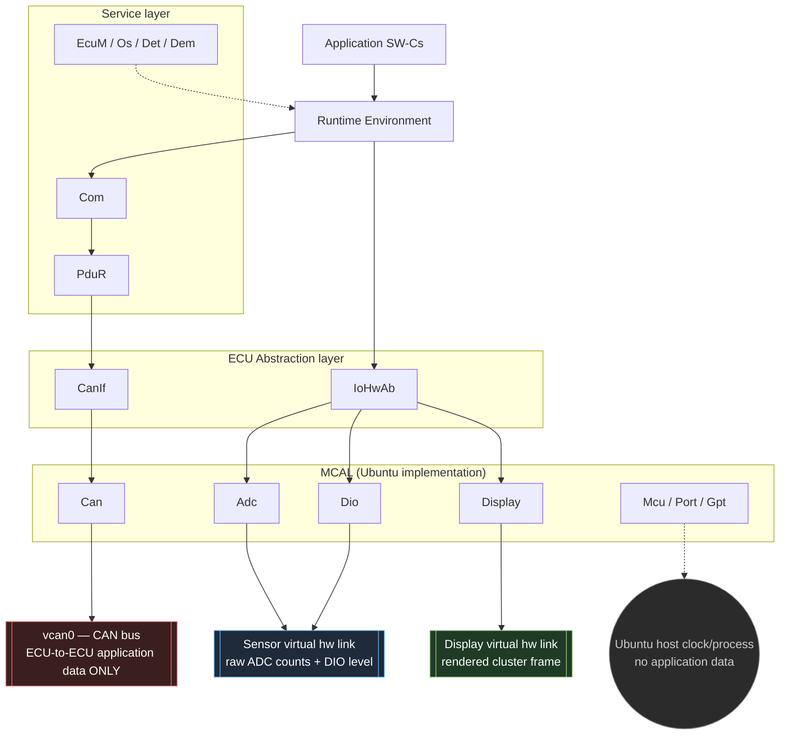
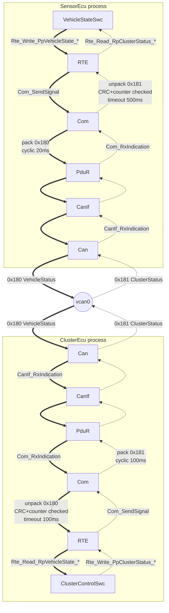

# Architecture

This document summarizes the architecture defined in
`AUTOSAR_CLASSIC_PROJECT_SPEC_v1.1.md`. It is a companion, not a
replacement — the specification is authoritative; this file is updated as
each implementation phase (section 16 of the spec) lands so it stays true
to the actual code rather than only the plan.

## Layers and vertical paths



Three separate destination nodes are drawn on purpose, not one merged
"host" box: `Can` reaches only `vcan0`, `Adc`/`Dio` reach only the sensor
line, `Display` reaches only the display line, and `Mcu`/`Port`/`Gpt` touch
the host clock/process but carry no application data. All of these happen
to run inside the same Ubuntu process in this simulation, but that is an
implementation detail, not an architectural relationship — a diagram that
merges them invites the (wrong) reading that sensor/display traffic and
CAN traffic share a channel, which the channel table below forbids.

Two vertical paths, both mandatory:

- **Communication path**: `SW-C -> RTE -> Com -> PduR -> CanIf -> Can -> vcan0`
- **I/O path**: `SW-C -> RTE -> IoHwAb -> Adc / Dio / Display -> virtual hardware link` (sensor line for `Adc`/`Dio`, display line for `Display` — never the same link)

The MCAL (`bsw/mcal/`) is the sole substitution boundary: every host-specific
artifact (sockets, file descriptors, `clock_gettime`, the CAN interface
name) lives at or below it. Porting to a real microcontroller means
rewriting `bsw/mcal/` and nothing else — see `REQ-ARCH-012`.

Full layer ownership / allowed-dependency table: spec section 3.1.

## EcuM initialization order — rationale

`EcuM_Init` follows a fixed order (spec section 9.2):

1. Logger
2. `Mcu_Init`, `Mcu_InitClock`
3. `Port_Init`
4. `Gpt_Init` + start time base
5. `Det_Init`
6. `Dem_Init`
7. Parse command-line (post-build-like) configuration
8. Input/output MCAL drivers (`Adc_Init`/`Dio_Init` or `Display_Init`)
9. `Can_Init`
10. `IoHwAb_Init`
11. `CanIf_Init`
12. `PduR_Init`
13. `Com_Init`
14. `Rte_Start`
15. CAN controller to `CAN_CS_STARTED`
16. Start COM I-PDU group (with init enabled)
17. Start OS schedule, enter `ECUM_STATE_RUN`

This is the standard AUTOSAR ordering rationale applied to this project:
**microcontroller and clock first** (nothing else can run without a time
base), **then pin configuration** (`Port`, so peripheral electrical setup
precedes any peripheral use), **then diagnostics** (`Det`/`Dem` before any
other module, so every later initialization failure is recordable rather
than silently lost), **then drivers bottom-up** (MCAL, then `Can`), **then
the ECU Abstraction layer** (`IoHwAb`) which depends on those drivers being
ready, **then the communication stack bottom-up** (`CanIf` → `PduR` →
`Com`, each depending on the layer initialized just before it), and
**finally the RTE**, which is the first layer allowed to reach application
code. Shutdown (section 9.3) is the same order reversed, so every module is
torn down only after everything that depends on it has already stopped.

## Data flow between the two ECUs

The layer diagram above shows one ECU in isolation. This diagram shows both
ECUs together, walking the same layers in both directions at once:
`SensorEcu` transmitting `VehicleStatus` (`0x180`) while simultaneously
receiving `ClusterStatus` (`0x181`), and vice versa for `ClusterEcu`. Both
PDUs are equally real data paths — the thick/dotted line style below is
used **only** to tell the two PDUs apart at a glance; it does not mean
"mandatory vs. optional" the way it did in the layer diagram above.



Reading this diagram:

- **Thick arrows** (`==>`): the `0x180 VehicleStatus` path, `SensorEcu` → `ClusterEcu`, produced every 20 ms, with a 100 ms reception deadline monitored on the `ClusterEcu` side.
- **Dotted arrows** (`-.->`): the `0x181 ClusterStatus` path, `ClusterEcu` → `SensorEcu`, produced every 100 ms, with a 500 ms reception deadline monitored on the `SensorEcu` side.
- Every box is used by **both** flows — `Com`, `PduR`, `CanIf`, and `Can` each run one Tx pipeline for the local ECU's own PDU and one Rx pipeline for the remote ECU's PDU, per the static routes in spec section 7.5. There are not two separate copies of these modules.
- `vcan0` is the only thing the two processes share. Nothing here bypasses it — the receiving `Com` only accepts a frame after `CanIf`/`PduR` hand it a fully-formed I-PDU, and only after CRC + alive-counter validation does the RTE buffer update (`REQ-COM-003`, `REQ-RTE-005`); a single invalid frame leaves the previous application values untouched.
- This diagram is the **Communication path** from the layer diagram above, drawn twice (once per direction) and joined at `vcan0`. It does not include the **I/O path** (sensor/display virtual links), which is internal to each ECU and never reaches the other ECU — see the layer diagram's channel-separation note.

## Beginner's guide to the diagram above (Vietnamese)

The following explains the same "Data flow between the two ECUs" diagram
using a plain-language analogy, for a reader new to AUTOSAR who wants the
mental model before the module names. Kept in Vietnamese intentionally —
it's written for a Vietnamese-speaking newcomer, not as a spec-level
document, so it doesn't follow the English-only convention of the rest of
this file.

### Sơ đồ này nói về việc gì? — dùng phép ví von "gửi thư"

Hãy tưởng tượng 2 ECU là **2 tòa nhà văn phòng**, mỗi tòa có nhiều **phòng
ban xếp chồng lên nhau** theo tầng, và giữa 2 tòa có **một con đường
chung duy nhất** để xe chở thư chạy qua lại — đó chính là `vcan0`.

Mỗi tòa nhà đều có đúng các phòng ban sau, xếp từ trên xuống:

```
Tầng trên cùng: Người viết/đọc thư     ← SW-C (VehicleStateSwc / ClusterControlSwc)
Tầng dưới: Trợ lý riêng                ← RTE
Tầng dưới nữa: Phòng đóng gói           ← Com
Tầng dưới nữa: Phòng phân loại          ← PduR
Tầng dưới nữa: Bưu cục                  ← CanIf
Tầng trệt: Bãi xe chở thư                ← Can
                     │
                  con đường chung        ← vcan0
```

### Đi từng bước một lượt thư "tốc độ xe" từ SensorEcu sang ClusterEcu

Giả sử cảm biến đo được xe đang chạy 120 km/h. Đây là hành trình lá thư
đi qua sơ đồ (nhánh **nét đậm** trong hình):

1. **`VehicleStateSwc`** (người viết thư, ở tòa SensorEcu): viết nội dung
   *"tốc độ = 12000"* (đơn vị 0.01 km/h). Người này **không hề biết** thư
   sẽ đi bằng phương tiện gì, địa chỉ ra sao — chỉ đưa cho trợ lý.
   → `Rte_Write_PpVehicleState_VehicleSpeedRaw(12000)`
2. **`RTE`** (trợ lý riêng): nhận nội dung, chuyển xuống phòng đóng gói
   theo đúng quy trình nội bộ đã định sẵn.
   → gọi `Com_SendSignal`
3. **`Com`** (phòng đóng gói): gom nội dung này + trạng thái ignition +
   một **số thứ tự tăng dần** (alive counter) + một **con tem chống giả
   mạo** (CRC8) vào đúng 1 phong bì 8 byte, cứ **20ms lại gói và gửi một
   lần** dù nội dung có đổi hay không.
   → đóng gói thành I-PDU `VehicleStatus`
4. **`PduR`** (phòng phân loại): nhìn vào bảng đã treo sẵn trên tường
   ("PDU này → gửi ra bưu cục theo route số 0"), **không đọc nội dung
   thư**, chỉ chuyển tiếp theo địa chỉ đã cấu hình sẵn.
5. **`CanIf`** (bưu cục): dịch "tên gọi nội bộ của thư" thành **địa chỉ
   thật trên đường** — ở đây là mã CAN ID `0x180`.
6. **`Can`** (bãi xe): bỏ thư lên xe, chạy ra con đường chung `vcan0`.
7. **Xe chạy trên `vcan0`** — đây là khoảnh khắc duy nhất lá thư rời khỏi
   tòa nhà SensorEcu.
8. Bên tòa **ClusterEcu**, `Can` của họ đứng ở bãi xe **luôn để ý xem có
   xe nào từ đường chạy vào không** (không chặn tiến trình khác —
   non-blocking).
9. **`CanIf`** bên ClusterEcu nhận thư, thấy CAN ID `0x180` → tra bảng
   biết đây là PDU nào.
10. **`PduR`** chuyển thư này tới đúng phòng `Com` phụ trách.
11. **`Com`** bên ClusterEcu **xé phong bì**: kiểm tra tem chống giả mạo
    (CRC) trước, rồi kiểm tra số thứ tự có đúng "số liền trước + 1"
    không. **Nếu 1 trong 2 cái sai → vứt cả lá thư, không cập nhật gì
    hết** — đây chính là ý nghĩa dòng chữ "CRC+counter checked" trong sơ
    đồ.
12. Nếu thư hợp lệ, `Com` mới đưa nội dung cho `RTE`, và `RTE` mới đưa
    cho **`ClusterControlSwc`** (người đọc thư) — người này đọc được
    *"tốc độ = 12000"* và tự quyết định: 120 km/h > ngưỡng 100 km/h →
    chuyển trạng thái sang **OVERSPEED**.

### Vậy còn nhánh nét chấm là gì?

Đó là **lá thư đi chiều ngược lại**: `ClusterControlSwc` viết trạng thái
cụm đồng hồ (OFF/NORMAL/OVERSPEED...) rồi gửi ngược về cho `SensorEcu`
biết, qua đúng các phòng ban y hệt nhưng **đi ngược chiều**, đóng gói
thành CAN ID khác (`0x181`), chu kỳ gửi thưa hơn (100ms thay vì 20ms).

Điều thú vị: **cùng một phòng `Com`, một phòng `PduR`, một bưu cục
`CanIf`, một bãi xe `Can`** — nhưng vừa xử lý thư gửi đi (`0x181`) vừa xử
lý thư nhận vào (`0x180`). Không phải 2 bộ phòng ban riêng biệt cho 2
chiều. Đó là lý do trong sơ đồ, mỗi ô hình chữ nhật có **cả mũi tên nét
đậm lẫn nét chấm đi qua nó**.

### Vì sao phải qua nhiều phòng ban rắc rối vậy, gửi thẳng có được không?

Vì nếu `VehicleStateSwc` tự mình biết CAN ID là `0x180`, tự đóng gói
byte, tự gọi socket — thì khi thay đổi loại xe (đổi CAN ID) hoặc đổi hẳn
sang chip vi điều khiển thật, ta phải **sửa lại code người viết thư**.
Nhưng với cách chia phòng ban này, người viết thư **không bao giờ phải
đổi** — chỉ có "bưu cục" (`CanIf`) hay "bãi xe" (`Can`) cần đổi khi đổi
phần cứng. Đây chính là lý do AUTOSAR chia lớp: **mỗi lỗi/thay đổi chỉ
ảnh hưởng đúng 1 tầng**, không lan ra toàn bộ tòa nhà.

### Timeout (deadline) nghĩa là gì trong ví dụ này?

Nếu quá **100ms mà SensorEcu không thấy có thư mới nào từ ClusterEcu bay
tới** (bình thường 100ms có 1 thư), `SensorEcu` sẽ nghĩ *"chắc đường dây
bị đứt hoặc tòa bên kia sập"* → tự báo lỗi
(`DEM_EVENT_CLUSTER_STATUS_TIMEOUT`). Tương tự chiều ngược lại, nếu
ClusterEcu quá 100ms không nhận được `0x180`, nó sẽ chuyển sang trạng
thái `COMM_FAULT` (mất liên lạc) — thay vì cứ hiển thị mãi tốc độ cũ như
không có chuyện gì xảy ra, điều đó rất nguy hiểm trên xe thật.

Tóm gọn 1 câu: **sơ đồ này là 2 tòa nhà giống hệt nhau, đứng quay lưng
vào nhau, chia sẻ đúng 1 con đường ở tầng trệt, và mỗi tòa vừa gửi thư đi
vừa nhận thư về qua đúng các phòng ban đó — không ai trong tòa nhà biết
"con đường" trông ra sao, trừ đúng phòng `Can` ở tầng trệt.**

## Implementation status

See `docs/IMPLEMENTATION_STATUS.md` for the current phase-by-phase status.
As of Phase 0, only the directory skeleton, build graph, and placeholder
executables exist; the layering, routing, and lifecycle behavior described
above are the target this repository is being built toward, not yet the
observed behavior of the code.
