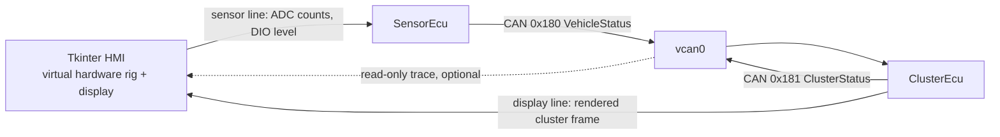
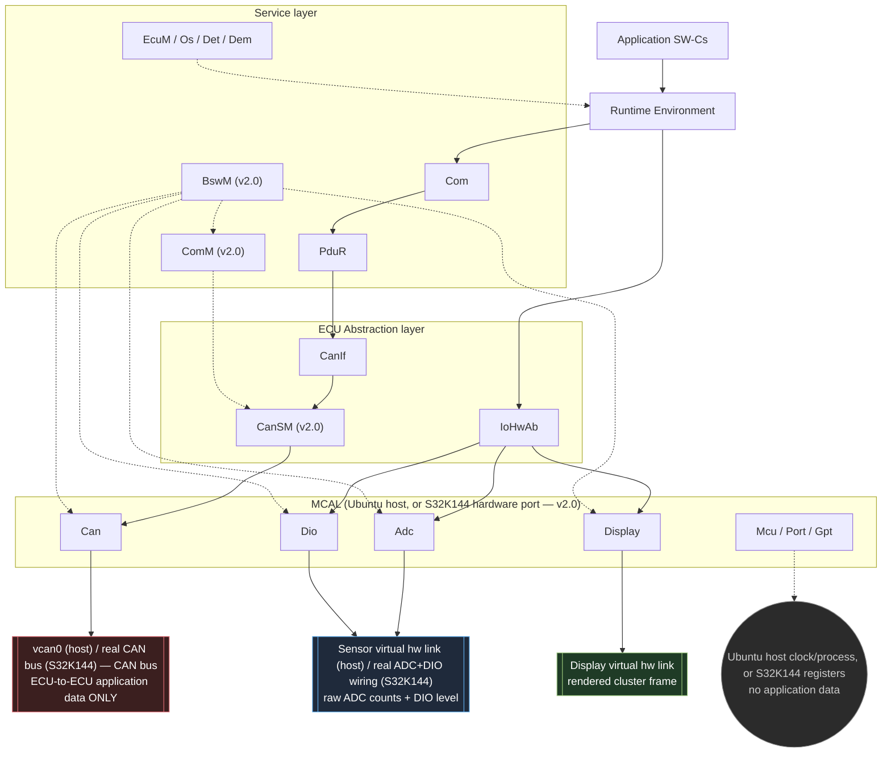
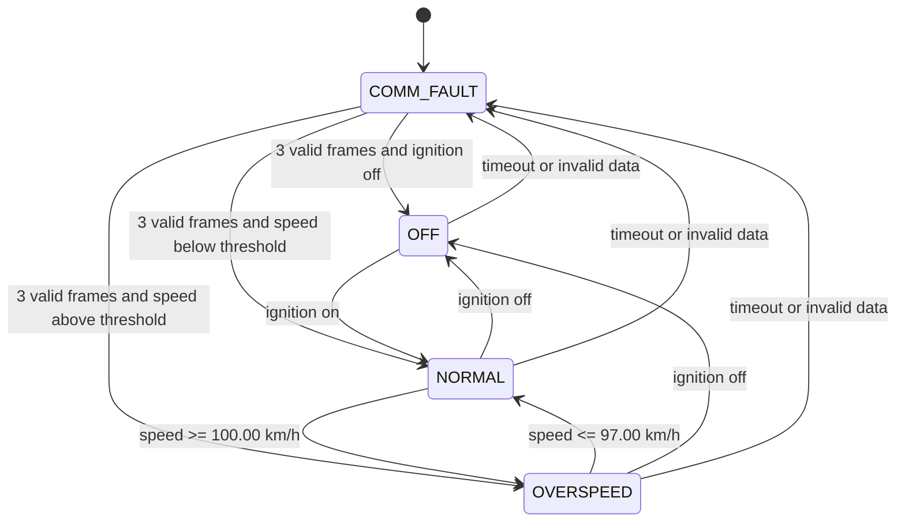
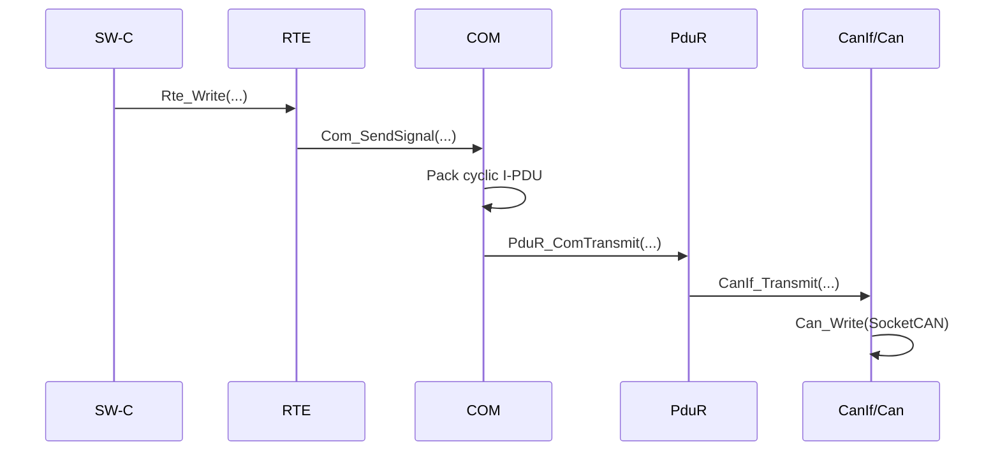
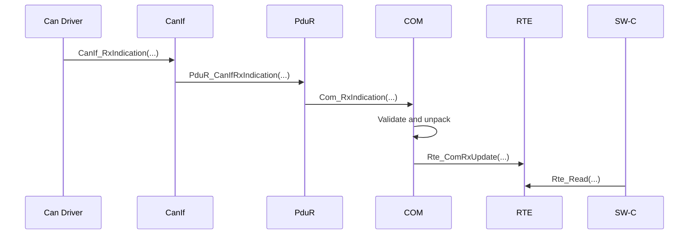
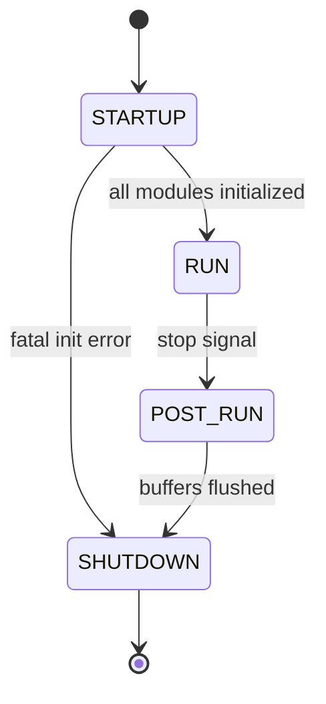

# AUTOSAR Classic - Architecture and Implementation Specification

## 0. Document control

| Field | Value |
|---|---|
| Project | Simplified AUTOSAR Classic Vehicle Speed Monitor |
| Document role | Architecture, implementation contract, and acceptance criteria for Claude Code |
| Target platform | Ubuntu 22.04 LTS or Ubuntu 24.04 LTS, x86_64 (host reference target); NXP S32K144 (Arm Cortex-M4F) bare-metal (hardware-port target, section 16 Phase 9) |
| Runtime | Two ECU processes in C11, SocketCAN `vcan0`, one Python 3 Tkinter HMI process (host target); two bare-metal images on S32K144 sharing the same `asw/`, `rte/`, and `bsw/` above `bsw/mcal/` (hardware-port target) |
| Architectural emphasis | Complete Classic Platform vertical stack in both directions: ASW / RTE / Service / ECU Abstraction / MCAL, plus BSW Mode Management (`BswM` / `ComM` / `CanSM`) driving communication and ECU state |
| Intended reader | Developer implementing the repository from scratch |
| Language | English specification; AUTOSAR identifiers retained |
| Status | Baseline v1.1; extended by v2.0 (section 0.3) |

### 0.1 Important qualification

This project is an educational, AUTOSAR-inspired implementation. It shall reproduce the main architectural boundaries, data flow, naming style, static configuration approach, and development discipline of AUTOSAR Classic Platform. It shall **not** claim AUTOSAR conformance, replace a licensed BSW stack, or pretend that hand-written configuration is schema-compliant ARXML.

The implementation must stay small enough to understand end-to-end while remaining structurally close to a real ECU project.

### 0.2 How Claude Code must use this document

1. Treat every statement marked `MUST` or `SHALL` as mandatory.
2. Treat every requirement ID as traceable to code and tests.
3. Implement in the phases defined in section 16; do not generate the whole repository as one unreviewed code dump.
4. At the end of each phase, build, run the relevant tests, and update `docs/IMPLEMENTATION_STATUS.md`.
5. If a detail is missing, choose the smallest deterministic solution that preserves the layer boundaries in this document.
6. Do not add unrelated AUTOSAR modules merely to make the project look larger.
7. Never let the Tkinter HMI, the virtual hardware links, or the host operating system leak above the MCAL boundary.

### 0.3 Change log

| Version | Change |
|---|---|
| v1.0 | Baseline: two ECUs, communication stack, scenario CSV read inside the ECU, Tkinter tool as an optional admin backdoor |
| v1.2 | The OS time source is separated from `Gpt`. A dedicated MCAL driver `SysTimer` feeds an OS-owned counter layer `Os_Counter`; `Gpt` keeps its API but now serves only the other BSW modules (COM deadlines and Tx period, IoHwAb staleness, Dem/Det timestamps, Display write pacing, Logger timestamps). Reason: in real AUTOSAR the OS owns a dedicated hardware timer (SysTick, STM) and nothing else shares it, for safety, certification, and initialization-order reasons — a single shared `Gpt` misrepresented that and made the code misleading to read. Both drivers remain under `bsw/mcal/`, so `REQ-ARCH-009` is unchanged. |
| v1.1 | Target fixed to Ubuntu. A real MCAL boundary is introduced (`Mcu`, `Port`, `Gpt`, `Adc`, `Dio`, `Can`, `Display`) plus an `IoHwAb` ECU Abstraction layer. Sensor values no longer originate inside the ECU: they enter as raw ADC counts and digital levels through a virtual hardware link, exactly as a physical sensor would. The Tkinter application is promoted from a debug backdoor to the specified virtual hardware rig and instrument display, and the CSV scenario moves out of the ECU into a headless player that drives the same link. |
| v2.0 | Two extensions, tracked as Phase 9 (section 16): (1) **Hardware port** — future extension item 1 of section 18 is delivered: a real MCAL for the NXP S32K144 (`Mcu`, `Port`, `Gpt`/`SysTimer`, `Adc`, `Dio`, `Can`, register-level, under `bsw/mcal/*_S32K144.c` and `platform/s32k144/`), built via `cmake/s32k144_toolchain.cmake`, with no change required outside `bsw/mcal/` (`REQ-ARCH-012` upheld). (2) **BSW Mode Management** — `ComM` (communication mode requests/users), `CanSM` (per-controller CAN state machine translating a `ComM` mode into `CanIf`/`Can` controller state), and `BswM` (the central startup/shutdown/mode arbitration module coordinating `EcuM`, `ComM`, and the driver init/deinit action lists) are added under `bsw/services/ComM/`, `bsw/communication/CanSM/`, and `bsw/services/BswM/`. Reason: v1's `EcuM` inlined communication-mode and driver-lifecycle decisions that real AUTOSAR splits across `ComM`/`CanSM`/`BswM`; an interview-facing project benefits from showing the real module split and the real arbitration contract, not a shortcut. This remains an educational, non-conformant implementation per section 0.1 — see section 1.3 for what stays explicitly out of scope. |

The intent of v1.1 is architectural fidelity: an ECU never invents its own input, and an application component never learns where its input came from. The intent of v1.2 is the same fidelity applied to time: the OS clock and the general-purpose clock are two separate, independently managed paths, exactly as on a real ECU. The intent of v2.0 is fidelity applied to two more axes real AUTOSAR work always separates: the MCAL/silicon boundary (v1 only ever simulated it) and BSW mode management (v1 collapsed it into `EcuM`).

---

## 1. Goal and scope

### 1.1 Goal

Build a demonstrable two-ECU system on Ubuntu in which:

- A Tkinter application acts as the **virtual vehicle hardware**: it emits raw wheel-speed sensor counts and an ignition digital level, and it renders the instrument display driven by `ClusterEcu`.
- `SensorEcu` acquires those inputs through the full input path
  `virtual sensor line -> Adc/Dio (MCAL) -> IoHwAb (ECU Abstraction) -> RTE -> SW-C`.
- `SensorEcu` publishes `VehicleStatus` on CAN every 20 ms.
- `ClusterEcu` receives and validates the data, calculates the cluster state, and publishes `ClusterStatus` every 100 ms.
- `ClusterEcu` drives its display through the full output path
  `SW-C -> RTE -> IoHwAb -> Display (MCAL) -> virtual display line`.
- Both communication directions traverse the complete simplified Classic Platform path:
  `SW-C -> RTE -> COM -> PduR -> CanIf -> Can Driver -> SocketCAN`.
- Receive traffic traverses the reverse path and updates an RTE receive buffer.
- Periodic runnable activation, ECU initialization, error reporting, timeout supervision, and static configuration are visible in code.

The teaching goal is that a reader can point at any line of application code and answer three questions: which layer owns it, which layer is allowed to call it, and what would have to change if the ECU moved from an Ubuntu host to a real microcontroller. Under this design the answer to the third question is always "only the MCAL".

### 1.2 In scope

- Application Software Components (SW-Cs)
- Generated-style RTE APIs and buffers
- Simplified `Com`, `PduR`, `CanIf`, and `Can` modules
- Simplified `EcuM`, `Os`, `Det`, and `Dem`
- Simplified MCAL for the Ubuntu target: `Mcu`, `Port`, `Gpt`, `Adc`, `Dio`, `Can`, and a `Display` output driver
- `IoHwAb` ECU Abstraction: raw-to-physical conversion, plausibility, and signal validity
- Virtual hardware links: two `AF_UNIX` datagram channels modelling sensor wiring and display wiring
- Tkinter HMI (`tools/hmi/vehicle_hmi.py`): sensor rig, instrument display, optional CAN trace
- Headless scenario player driving the same virtual sensor line for CI
- Classic CAN, 11-bit identifier, 8-byte payload
- Static configuration in `*_Cfg.c` and `*_Cfg.h`
- Two ECU processes on Ubuntu communicating through `vcan0`
- Unit tests and end-to-end integration tests
- Deterministic, single-threaded execution per ECU process
- **(v2.0, Phase 9)** A register-level MCAL for the NXP S32K144 (`Mcu`, `Port`, `Gpt`/`SysTimer`, `Adc`, `Dio`, `Can`), selectable at configure time via `cmake/s32k144_toolchain.cmake`, with no change above `bsw/mcal/`
- **(v2.0, Phase 9)** Simplified `ComM` (communication mode requests/users), `CanSM` (per-controller CAN state machine), and `BswM` (startup/shutdown/mode arbitration), as a real module split instead of `EcuM` deciding communication mode and driver lifecycle directly

### 1.3 Out of scope for v1 (see v2.0 note below for what Phase 9 adds)

- Full AUTOSAR specification conformance
- Vendor BSW, real RTE/BSW generators, or production ARXML toolchains
- UDS/DCM, NvM, bootloader, cryptographic stack, SecOC
- Nm (Network Management) bus-sleep/wake coordination — `ComM` (v2.0) models communication-mode users and requests, but no Nm PDU/sleep state machine exists
- CAN TP, large diagnostic payloads, CAN FD, LIN, FlexRay, or Ethernet
- Multi-core OS, memory protection, timing protection, MPU, or ASIL certification
- Production E2E Profile implementation
- Calibration/XCP and A2L generation
- Analog electrical modelling: sensor noise, filtering, ADC nonlinearity, and debounce beyond one simple plausibility window
- Any host distribution other than Ubuntu 22.04/24.04 x86_64, and any silicon target other than the S32K144 added in v2.0; other systems may work but are not claimed or tested

**v2.0 note:** as of Phase 9, the S32K144 MCAL is real register-level code (not a simulation of hardware-shaped APIs), and `ComM`/`CanSM`/`BswM` are real, if simplified, BSW modules. This still does **not** amount to full AUTOSAR specification conformance (no certified BSW, no schema-valid ARXML, no Nm, no ASIL work products) — section 0.1's qualification stands unchanged.

### 1.4 Design principles

- Keep ASW independent of CAN IDs, byte positions, SocketCAN, OS task functions, ADC channels, and physical scaling.
- Let input enter the ECU only from the bottom of the stack. No layer above MCAL may synthesize a sensor value.
- Keep every host dependency, socket, and file descriptor inside MCAL, so the MCAL directory is the complete list of things a hardware port would rewrite.
- Keep the HMI outside the ECU boundary; it is test equipment plugged into the wiring, not part of the software architecture.
- Keep communication routing in configuration, not in application conditionals.
- Use RTE APIs as the only normal communication path for SW-Cs.
- Use static allocation only after initialization.
- Separate generic module code from ECU-specific configuration.
- Make every periodic behavior and timeout measurable in tests.
- Prefer generated-style repetitive code over clever but opaque abstractions.

---

## 2. System context



Three separate channel classes exist and they must never be confused:

| Channel | Models | Allowed content |
|---|---|---|
| `vcan0` | The vehicle CAN bus | ECU-to-ECU application communication only |
| Sensor line | The wiring between a wheel-speed sensor / ignition switch and the `SensorEcu` pins | Raw hardware quantities only, terminating in MCAL |
| Display line | The wiring between `ClusterEcu` and its display panel | Rendered display content only, originating in MCAL |

The CAN bus is the only inter-ECU data path. Test processes may observe or inject CAN traffic, but normal ECU-to-ECU communication must never use shared memory, files, TCP/UDP, the virtual hardware links, or direct function calls. Equally, the virtual hardware links must never be used to move application data between the two ECUs; they terminate inside one ECU's MCAL.

The Tkinter HMI is a third process. It replaces the physical hardware of both ECUs and the workshop test bench, and it holds no part of the ECU software architecture.

### 2.1 ECU responsibilities

| ECU | Responsibilities |
|---|---|
| `SensorEcu` | Sample the wheel-speed and ignition hardware channels, convert raw values to physical units and validity, publish vehicle speed and ignition on CAN, receive cluster status, supervise the remote status timeout, expose diagnostic logs |
| `ClusterEcu` | Receive and validate vehicle status, calculate `OFF/NORMAL/OVERSPEED/COMM_FAULT`, publish displayed speed and status flags on CAN, drive the instrument display output, expose diagnostic logs |
| Tkinter HMI (not an ECU) | Generate raw sensor stimuli, inject sensor-line faults, render whatever the cluster display driver sends, and optionally trace `vcan0` |

### 2.2 Main use cases

| ID | Use case | Expected result |
|---|---|---|
| UC-01 | Ignition off | Cluster state is `OFF`; overspeed warning is clear |
| UC-02 | Ignition on, speed below threshold | Cluster state is `NORMAL` |
| UC-03 | Speed rises above threshold | Cluster state becomes `OVERSPEED` |
| UC-04 | Speed falls below hysteresis exit threshold | Cluster state returns to `NORMAL` |
| UC-05 | `VehicleStatus` is missing for more than 100 ms | Cluster state becomes `COMM_FAULT`; DEM event is failed |
| UC-06 | Three consecutive valid frames arrive after a communication fault | Cluster exits `COMM_FAULT` and DEM event becomes passed |
| UC-07 | CRC or alive-counter validation fails | Frame is rejected; diagnostic counter/event is updated |
| UC-08 | SIGINT/SIGTERM is received | ECU performs an orderly shutdown and closes the CAN socket and hardware links |
| UC-09 | The HMI slider is moved | New ADC counts reach `Adc`, `IoHwAb` converts them, and the change is visible in `0x180` within 30 ms and on the cluster display within 130 ms |
| UC-10 | The sensor line is disconnected in the HMI | `IoHwAb` reports invalid input within 500 ms; `SensorEcu` publishes speed 0 and ignition off; `DEM_EVENT_SENSOR_LINK_LOST` fails |
| UC-11 | The HMI is started after the ECUs, or is closed while they run | Both ECUs continue running; the display link failure is counted and reported, never fatal |

---

## 3. Logical AUTOSAR architecture



Three separate destination nodes are drawn on purpose, not one merged "host"
box: `Can` reaches only `vcan0`/the real CAN bus, `Adc`/`Dio` reach only the
sensor line/wiring, `Display` reaches only the display line, and
`Mcu`/`Port`/`Gpt` touch the host clock/process or MCU registers but carry no
application data at all. A single ECU process (host) or firmware image
(S32K144) happens to host all of these, but that is an implementation
detail, not an architectural relationship — drawing them as one box (as in
the superseded v1.1 diagram below) reads as if sensor/display traffic and
CAN traffic share a channel, which section 2's channel table explicitly
forbids.

Two vertical paths exist and both are mandatory:

- **Communication path**: `SW-C -> RTE -> Com -> PduR -> CanIf -> CanSM -> Can -> vcan0`. (v2.0: `CanIf` no longer drives `Can`'s controller mode directly — `CanSM` does, on `ComM`'s behalf; `CanIf`'s PDU-level Tx/Rx path to `Can` is unchanged.)
- **I/O path**: `SW-C -> RTE -> IoHwAb -> Adc / Dio / Display -> virtual hardware link` (sensor line for `Adc`/`Dio`, display line for `Display` — never the same link).

`Det`, `Dem`, `EcuM`, and the simplified `Os` are service-layer modules. They support both vertical paths but are not alternative data paths for SW-Cs. `BswM` and `ComM` (v2.0, section 9.4) are also service-layer: `BswM` triggers the driver init/deinit action lists (dashed arrows above) that `EcuM` used to sequence directly, and arbitrates who requests communication mode; `ComM` forwards the arbitrated mode to `CanSM`.

The MCAL is the substitution boundary of the whole project. Every host-specific artifact — sockets, file descriptors, `clock_gettime`, signal handling of the CAN interface name — lives at or below it. Porting to an STM32 or S32K means rewriting `bsw/mcal/` and nothing else — as of v2.0 (Phase 9), this has been done once, for the S32K144.

### 3.1 Layer ownership and allowed dependencies

| Layer/module | Owns | May call | Must not know |
|---|---|---|---|
| SW-C | Functional behavior and state | Only its own generated `Rte_*` APIs | CAN ID, PDU ID, byte layout, SocketCAN, OS task APIs |
| RTE | Port API, buffers, runnable invocation glue | COM signal APIs and approved service adapters | SocketCAN and physical CAN frame filters |
| COM | Signal serialization, I-PDU scheduling, invalidation, timeout supervision | PduR transmit and RTE indication adapter | Host socket details |
| PduR | Static PDU routing | Destination module APIs | Signal semantics and byte layout |
| CanIf | CAN PDU abstraction, ID/filter mapping, controller state | Can Driver | SW-C ports and application meaning |
| IoHwAb | Raw-to-physical conversion, scaling, plausibility window, signal validity, display value assembly | `Adc`, `Dio`, `Display` APIs | Socket paths, ADC bit width origin, CAN, cluster state machine rules |
| Can Driver | SocketCAN transport and controller state | POSIX/Ubuntu socket APIs | COM signals and application logic |
| Adc (MCAL) | Conversion result of the wheel-speed channel as raw counts | Virtual hardware link and DET | Physical units, km/h, application meaning |
| Dio (MCAL) | Level of the ignition channel | Virtual hardware link and DET | Physical units and application meaning |
| Display (MCAL) | Byte-level output of one display frame | Virtual hardware link and DET | Why a state is shown, cluster logic |
| Mcu, Port, Gpt (MCAL) | Startup, channel setup, general-purpose time base for BSW modules | Host clock/registers and link creation | Anything above the MCAL boundary, and the OS time base |
| SysTimer (MCAL) | The dedicated OS system timer: free-running tick source owned solely by the OS | Host clock/registers | Every module except `Os_Counter`; it never calls `Gpt` |
| EcuM | Initialization/shutdown state machine | Init/deinit APIs in defined order, and `BswM` to run the mode-dependent action lists (v2.0) | Application control algorithm, and (v2.0) which drivers a given mode initializes — that is `BswM`'s table, not `EcuM`'s |
| BswM (v2.0) | Startup/shutdown/mode action lists: which BSW modules get initialized/deinitialized for a given mode, and arbitration between requesters | `ComM`, `CanIf`, `IoHwAb`, `Com`, MCAL init/deinit APIs named in its own action-list configuration | Application control algorithm, CAN ID/signal semantics |
| ComM (v2.0) | Communication-mode user bookkeeping and the arbitrated channel mode (`NO_COM`/`SILENT_COM`/`FULL_COM`) | `CanSM` mode-request API | Physical CAN controller registers, signal semantics |
| CanSM (v2.0) | One CAN-channel state machine translating a `ComM` mode into `CanIf`/`Can` controller transitions | `CanIf` controller-mode API | `ComM` user bookkeeping, application data |
| Os | Periodic activation and priority order | Task entry functions and `Os_Counter` | Signal encoding, CAN routing, `Gpt`, and (unchanged by v2.0) `BswM`/service-layer state — `REQ-ARCH-015` |
| Os_Counter | OS counter over the OS tick source: zeroing, tick-to-millisecond conversion | `SysTimer` only | `Gpt`, the host clock API, and anything above the OS |
| Det | Development error records | Logger backend | Recovery policy |
| Dem | Diagnostic event state and occurrence counters | Logger backend | SocketCAN implementation details |

### 3.2 Mandatory layering requirements

- `REQ-ARCH-001`: SW-C source files SHALL include only their matching `Rte_<Swc>.h`, application-local headers, and standard fixed-width headers.
- `REQ-ARCH-002`: No SW-C file SHALL include `Com.h`, `PduR.h`, `CanIf.h`, `Can.h`, `IoHwAb.h`, any MCAL header, Ubuntu CAN or socket headers, or ECU configuration headers.
- `REQ-ARCH-003`: `PduR` SHALL route by static tables; it SHALL NOT inspect application signal values.
- `REQ-ARCH-004`: `CanIf` SHALL map logical CAN PDU IDs to physical CAN IDs through ECU configuration.
- `REQ-ARCH-005`: Generic module implementation SHALL be shared by both ECUs; differences SHALL reside in configuration and generated RTE code.
- `REQ-ARCH-006`: No normal cross-layer call may skip a module shown in the main communication path.
- `REQ-ARCH-007`: Any intentional shortcut needed for test instrumentation SHALL live under `tests/` or `tools/` and SHALL NOT be linked into production ECU targets.
- `REQ-ARCH-008`: SW-Cs SHALL obtain sensor input and produce display output only through RTE ports. No SW-C source file SHALL call `IoHwAb_*`, `Adc_*`, `Dio_*`, or `Display_*`.
- `REQ-ARCH-009`: MCAL SHALL be the only layer that creates, reads, or writes a virtual hardware link. No file above `bsw/mcal/` SHALL include `sys/socket.h`, `sys/un.h`, `linux/can.h`, or contain a socket path literal.
- `REQ-ARCH-010`: MCAL SHALL exchange raw hardware quantities only: ADC counts, digital levels, and display bytes. Conversion to 0.01 km/h, plausibility, and validity SHALL happen in `IoHwAb`.
- `REQ-ARCH-011`: The Tkinter HMI SHALL run as a separate process, SHALL be written in Python using only the standard library, and SHALL NOT include, import, link, or generate ECU source. It communicates only through the virtual hardware links and an optional read-only `vcan0` socket.
- `REQ-ARCH-012`: Replacing the Ubuntu MCAL with a microcontroller MCAL SHALL require no change in `asw/`, `rte/`, or any `bsw/` directory other than `bsw/mcal/`. A static check SHALL support this claim.
- `REQ-ARCH-013`: No ECU source file SHALL contain the words `scenario`, `slider`, `gui`, or `hmi` in a functional role. The ECU does not know how its stimuli are produced.
- `REQ-ARCH-014`: The OS time source SHALL be separate from the general-purpose timer. No file under `bsw/os/` SHALL contain `Gpt_`; `Os` SHALL take all time from `Os_Counter`, which SHALL read `SysTimer` and nothing else. A static check SHALL enforce this.
- `REQ-ARCH-015` (v2.0): `Os` is a generic scheduling primitive and SHALL NOT reference any service-layer type or enum, including `BswM`'s state. No file under `bsw/os/` SHALL include `BswM.h` or otherwise name a `BSWM_*` symbol; a mode gate belongs in the `startupHook`/`EcuM` glue that configures `Os`, not inside `Os` itself.
- `REQ-ARCH-016` (v2.0): Selecting the S32K144 MCAL variant (`-DAUTOSAR_MCAL_VARIANT=s32k144` with `cmake/s32k144_toolchain.cmake`) SHALL build and link only the bare-metal ECU images; it SHALL NOT attempt to build the Ubuntu-only unit test targets or any target that calls a POSIX API (`sigaction`, `nanosleep`, sockets), since those cannot link against `-specs=nosys.specs`.

---

## 4. Application software components

### 4.1 `SensorEcu` SW-Cs

#### 4.1.1 `VehicleStateSwc`

Purpose: acquire local vehicle inputs and publish the vehicle state.

Runnables:

| Runnable | Activation | Behavior |
|---|---:|---|
| `VehicleStateSwc_Init` | `Rte_Start` | Initialize local state only; do not transmit |
| `VehicleStateSwc_10ms` | Timing event, 10 ms | Call the vehicle input service through RTE, evaluate the returned validity, clamp values, and write vehicle state to RTE |
| `VehicleStateSwc_100ms` | Timing event, 100 ms | Read remote cluster status and update a local supervision summary for logging |

Ports:

| Port | Direction | Interface | Elements/operations |
|---|---|---|---|
| `PpVehicleState` | Provided | `IF_VehicleState` | `VehicleSpeedRaw`, `IgnitionOn` |
| `RpClusterStatus` | Required | `IF_ClusterStatus` | `ClusterState`, `DisplayedSpeedRaw`, `StatusFlags` |
| `RpVehicleInputs` | Required client | `IF_VehicleInputs` | `GetVehicleInputs(speedRaw, ignitionOn, validity)` |

#### 4.1.2 Vehicle input path

Vehicle speed and ignition are **not** produced inside the ECU. They enter at the bottom of the stack exactly as they would on a real ECU, and each layer adds exactly one thing.

| Step | Owner | Data at this step |
|---:|---|---|
| 1 | Virtual sensor line | One datagram from the HMI or scenario player: ADC counts and ignition level |
| 2 | `Adc` (MCAL) | Latest conversion result of group `AdcGroup_WheelSpeed`, 0..4095 counts, plus a freshness stamp |
| 3 | `Dio` (MCAL) | Level of channel `DioChannel_Ignition`, `STD_LOW` or `STD_HIGH` |
| 4 | `IoHwAb` | Counts scaled to 0.01 km/h, plausibility window applied, validity produced |
| 5 | RTE | `Rte_Call_RpVehicleInputs_GetVehicleInputs` returns value plus validity to the SW-C |
| 6 | `VehicleStateSwc` | Clamps, applies the invalid-input policy, writes the vehicle state ports |

Conversion contract:

- Sensor full scale SHALL be 250.00 km/h at 4095 counts, 0.00 km/h at 0 counts, linear.
- `speed_raw = (adc_counts * 25000) / 4095`, integer division, computed in `IoHwAb` with 32-bit intermediates.
- Scaling constants SHALL live in `IoHwAb_Cfg`, never in a SW-C or in MCAL.
- The plausibility window SHALL be configurable; counts outside it SHALL be reported through DEM and treated as invalid.

Requirements:

- `REQ-IOHWAB-001`: `IoHwAb` SHALL return both a value and a validity for every input; it SHALL never return a stale value marked valid.
- `REQ-IOHWAB-002`: If no fresh hardware value has been sampled within `IOHWAB_INPUT_TIMEOUT_MS`, default 500 ms, validity SHALL be `IOHWAB_INVALID`.
- `REQ-IOHWAB-003`: On `IOHWAB_INVALID`, `VehicleStateSwc` SHALL publish speed 0 and ignition off. It SHALL NOT freeze the last good value, because a frozen speed is the more dangerous failure on a cluster.
- `REQ-IOHWAB-004`: `IoHwAb` SHALL set `DEM_EVENT_SENSOR_LINK_LOST` and `DEM_EVENT_SPEED_SENSOR_RANGE`; it SHALL NOT decide any application state.
- `REQ-MCAL-001`: `Adc` and `Dio` SHALL return only the last value received from the hardware link together with its age; they SHALL perform no scaling, filtering, or interpretation.
- `REQ-MCAL-002`: MCAL reads SHALL be non-blocking and bounded per activation, as specified in section 15.5.

The deterministic CSV scenario of v1.0 is no longer parsed by the ECU. It is replayed onto the same virtual sensor line by `tools/hmi/scenario_player.py`; the CSV contract is specified in section 15.7. This removes the second input path and makes the CI test exercise exactly the code that a demo exercises.

### 4.2 `ClusterEcu` SW-C

#### 4.2.1 `ClusterControlSwc`

Purpose: transform the received vehicle state into a cluster state and publish a feedback status.

Runnables:

| Runnable | Activation | Behavior |
|---|---:|---|
| `ClusterControlSwc_Init` | `Rte_Start` | Initialize state to `COMM_FAULT` until valid remote data is received |
| `ClusterControlSwc_10ms` | Timing event, 10 ms | Read vehicle state, execute state machine, write cluster status to RTE |
| `ClusterControlSwc_100ms` | Timing event, 100 ms | Refresh the instrument display through the RTE display port, then produce a concise state/diagnostic log line |

Ports:

| Port | Direction | Interface | Elements |
|---|---|---|---|
| `RpVehicleState` | Required | `IF_VehicleState` | `VehicleSpeedRaw`, `IgnitionOn` |
| `PpClusterStatus` | Provided | `IF_ClusterStatus` | `ClusterState`, `DisplayedSpeedRaw`, `StatusFlags` |
| `RpDisplay` | Required client | `IF_ClusterDisplay` | `SetClusterDisplay(ClusterState, DisplayedSpeedRaw, StatusFlags)` |

`RpDisplay` is the only way the SW-C reaches the panel. The SW-C does not know that the panel is a Tkinter canvas, and a display write failure SHALL NOT change the cluster state machine.

### 4.3 Application data types

| Type | C representation | Physical meaning | Valid range |
|---|---|---|---|
| `VehicleSpeedRawType` | `uint16` | speed in 0.01 km/h per bit | 0..25000 |
| `IgnitionOnType` | `boolean` | ignition state | `FALSE/TRUE` |
| `DisplayedSpeedRawType` | `uint16` | displayed speed in 0.01 km/h per bit | 0..25000 |
| `ClusterStateType` | `uint8` enum | cluster state | 0..3 |
| `ClusterStatusFlagsType` | `uint8` bit field | warning and communication status | defined below |

`ClusterStateType` values:

| Value | Name |
|---:|---|
| 0 | `CLUSTER_STATE_OFF` |
| 1 | `CLUSTER_STATE_NORMAL` |
| 2 | `CLUSTER_STATE_OVERSPEED` |
| 3 | `CLUSTER_STATE_COMM_FAULT` |

`ClusterStatusFlagsType` bits:

| Bit | Meaning |
|---:|---|
| 0 | Overspeed warning active |
| 1 | Vehicle-status timeout active |
| 2 | Last vehicle-status frame failed CRC/counter validation |
| 3..7 | Reserved, transmit as zero |

### 4.4 Cluster state machine



State rules:

- `REQ-ASW-001`: Communication invalidity has higher priority than ignition and speed.
- `REQ-ASW-002`: Overspeed entry threshold SHALL be `10000` raw units (100.00 km/h).
- `REQ-ASW-003`: Overspeed exit threshold SHALL be `9700` raw units (97.00 km/h).
- `REQ-ASW-004`: The cluster SHALL require three consecutive valid `VehicleStatus` receptions to recover from `COMM_FAULT`.
- `REQ-ASW-005`: A single CRC/counter-invalid frame SHALL not update application signal values.
- `REQ-ASW-006`: Displayed speed SHALL be clamped to 250.00 km/h.

---

## 5. RTE contract

### 5.1 RTE responsibilities

- Provide SW-C-specific generated-style headers.
- Hold the local sender/receiver buffers.
- Return freshness/validity status on reads.
- Adapt local RTE signal writes to COM signal buffers.
- Adapt COM receive indications to RTE receive buffers.
- Invoke SW-C initialization and periodic runnables from task entry functions.
- Adapt SW-C client-server calls to the `IoHwAb` input and display services, so the SW-C never names an abstraction module.
- Prevent SW-Cs from depending on BSW headers.

### 5.2 Return values

Define a project-local `Rte_ReturnType` compatible with `Std_ReturnType`:

| Symbol | Value | Meaning |
|---|---:|---|
| `RTE_E_OK` | 0 | Valid data/service result |
| `RTE_E_NOT_OK` | 1 | Generic failure |
| `RTE_E_NEVER_RECEIVED` | 2 | No valid remote value since startup |
| `RTE_E_TIMEOUT` | 3 | Remote data exceeded configured deadline |
| `RTE_E_INVALID` | 4 | Last received frame failed integrity validation |
| `RTE_E_HARDWARE_INVALID` | 5 | Local input hardware value is missing, stale, or implausible |

`Rte_InputValidityType` mirrors `IoHwAb_ValidityType` one to one and is the only form in which hardware health reaches a SW-C. The SW-C learns that its input is untrustworthy; it never learns why, and never learns that a socket was involved.

### 5.3 Required generated-style APIs

`SensorEcu`:

```c
Rte_ReturnType Rte_Write_PpVehicleState_VehicleSpeedRaw(VehicleSpeedRawType value);
Rte_ReturnType Rte_Write_PpVehicleState_IgnitionOn(IgnitionOnType value);
Rte_ReturnType Rte_Read_RpClusterStatus_ClusterState(ClusterStateType *value);
Rte_ReturnType Rte_Read_RpClusterStatus_DisplayedSpeedRaw(DisplayedSpeedRawType *value);
Rte_ReturnType Rte_Read_RpClusterStatus_StatusFlags(ClusterStatusFlagsType *value);
Rte_ReturnType Rte_Call_RpVehicleInputs_GetVehicleInputs(
    VehicleSpeedRawType *speed_raw,
    IgnitionOnType *ignition_on,
    Rte_InputValidityType *validity);
```

`ClusterEcu`:

```c
Rte_ReturnType Rte_Read_RpVehicleState_VehicleSpeedRaw(VehicleSpeedRawType *value);
Rte_ReturnType Rte_Read_RpVehicleState_IgnitionOn(IgnitionOnType *value);
Rte_ReturnType Rte_Write_PpClusterStatus_ClusterState(ClusterStateType value);
Rte_ReturnType Rte_Write_PpClusterStatus_DisplayedSpeedRaw(DisplayedSpeedRawType value);
Rte_ReturnType Rte_Write_PpClusterStatus_StatusFlags(ClusterStatusFlagsType value);
Rte_ReturnType Rte_Call_RpDisplay_SetClusterDisplay(
    ClusterStateType state,
    DisplayedSpeedRawType displayed_speed_raw,
    ClusterStatusFlagsType flags);
```

Lifecycle APIs:

```c
Std_ReturnType Rte_Start(void);
Std_ReturnType Rte_Stop(void);
void Rte_Task_10ms(void);
void Rte_Task_100ms(void);
```

### 5.4 RTE behavior requirements

- `REQ-RTE-001`: Every pointer argument SHALL be checked before dereference; invalid pointers SHALL produce DET records.
- `REQ-RTE-002`: A read SHALL copy from an RTE-owned buffer, never expose an internal mutable pointer.
- `REQ-RTE-003`: Multi-element remote updates from one I-PDU SHALL become visible to the SW-C atomically from the perspective of the single ECU thread.
- `REQ-RTE-004`: `Rte_Write` SHALL update the RTE value and then call `Com_SendSignal` using a generated mapping.
- `REQ-RTE-005`: COM receive indication SHALL update the RTE buffer only after full PDU integrity validation.
- `REQ-RTE-006`: Initial RTE remote data state SHALL be `RTE_E_NEVER_RECEIVED`.
- `REQ-RTE-007`: RTE code SHALL be ECU-specific and live under `generated/`; SW-C code SHALL not edit RTE internals.

---

## 6. CAN communication design

### 6.1 Bus definition

| Property | Value |
|---|---|
| Interface | `vcan0` by default; overridable with `--can-if <name>` |
| Frame type | Classic CAN data frame |
| Identifier | Standard 11-bit |
| Payload | Fixed DLC 8 |
| Physical bitrate | Logical design value 500 kbit/s; not configured for vcan |
| Byte order | Little-endian for multi-byte signal values |

### 6.2 PDU and CAN ID matrix

| I-PDU | Sender | Receiver | CAN ID | Period | Deadline | DLC |
|---|---|---|---:|---:|---:|---:|
| `VehicleStatus` | `SensorEcu` | `ClusterEcu` | `0x180` | 20 ms | 100 ms | 8 |
| `ClusterStatus` | `ClusterEcu` | `SensorEcu` | `0x181` | 100 ms | 500 ms | 8 |

### 6.3 `VehicleStatus` payload, CAN ID `0x180`

| Byte | Bit(s) | Signal | Encoding |
|---:|---:|---|---|
| 0 | 0..7 | `VehicleSpeedRaw` low byte | uint16 little-endian |
| 1 | 0..7 | `VehicleSpeedRaw` high byte | uint16 little-endian |
| 2 | 0 | `IgnitionOn` | 0=false, 1=true |
| 2 | 1..7 | Reserved | transmit 0 |
| 3 | 0..3 | Alive counter | modulo 16 |
| 3 | 4..7 | Reserved | transmit 0 |
| 4 | 0..7 | CRC8 | algorithm in 6.5 |
| 5..7 | all | Reserved | transmit 0 |

### 6.4 `ClusterStatus` payload, CAN ID `0x181`

| Byte | Bit(s) | Signal | Encoding |
|---:|---:|---|---|
| 0 | 0..7 | `ClusterState` | enum 0..3 |
| 1 | 0..7 | `DisplayedSpeedRaw` low byte | uint16 little-endian |
| 2 | 0..7 | `DisplayedSpeedRaw` high byte | uint16 little-endian |
| 3 | 0..2 | `StatusFlags` | defined in 4.3 |
| 3 | 3..7 | Reserved | transmit 0 |
| 4 | 0..3 | Alive counter | modulo 16 |
| 4 | 4..7 | Reserved | transmit 0 |
| 5 | 0..7 | CRC8 | algorithm in 6.5 |
| 6..7 | all | Reserved | transmit 0 |

### 6.5 Educational integrity protection

This is intentionally called `ComProtection`, not `E2E`, because it is not a complete AUTOSAR E2E Profile implementation.

- CRC polynomial: `0x1D`
- Initial value: `0xFF`
- Final XOR: `0xFF`
- No reflection
- Input sequence: 16-bit `ProtectionDataId` high byte, low byte, then all eight payload bytes with the CRC byte temporarily set to zero
- `ProtectionDataId` is owned by COM configuration. It is set to `0x0180` for `VehicleStatus` and `0x0181` for `ClusterStatus`. The values intentionally equal the physical CAN IDs in this demo, but COM SHALL NOT read a CAN ID from CanIf or otherwise depend on physical bus configuration.
- Alive counter starts at zero after initialization and increments modulo 16 after each successful transmit request
- First valid received counter initializes receiver state
- Subsequent accepted counter must equal `(last_counter + 1) & 0x0F`
- A CRC or counter failure rejects the whole I-PDU

Golden vectors, where the listed CRC byte is initially zero during calculation:

| Protection Data ID | Payload before CRC | Expected CRC | Final payload |
|---:|---|---:|---|
| `0x180` | `D2 04 01 00 00 00 00 00` | `0x19` | `D2 04 01 00 19 00 00 00` |
| `0x181` | `01 D2 04 00 00 00 00 00` | `0xB0` | `01 D2 04 00 00 B0 00 00` |
| `0x180` | `10 27 01 0F 00 00 00 00` | `0xB1` | `10 27 01 0F B1 00 00 00` |

Requirements:

- `REQ-COM-001`: Reserved bits and bytes SHALL be zero on transmission.
- `REQ-COM-002`: The receiver SHALL verify DLC before accessing payload data.
- `REQ-COM-003`: The receiver SHALL validate CRC before alive counter and signals.
- `REQ-COM-004`: Invalid signal values or enum values SHALL invalidate the full PDU.
- `REQ-COM-005`: A timeout SHALL be based on monotonic reception time of the last valid frame, not the last raw frame.
- `REQ-COM-006`: Packing/unpacking SHALL use shifts and masks; it SHALL NOT cast the payload to a C struct.
- `REQ-COM-007`: Wire encoding SHALL not use floating-point values.

---

## 7. Communication stack behavior

### 7.1 Transmit path



Detailed rules:

1. SW-C writes application data through RTE.
2. RTE maps the data element to a logical `Com_SignalIdType`.
3. `Com_SendSignal` copies the value into the COM shadow buffer.
4. `Com_MainFunctionTx` evaluates the configured period.
5. When due, COM packs all signals, counter, reserved bytes, and CRC into an 8-byte I-PDU.
6. `PduR_ComTransmit` resolves the static route.
7. `CanIf_Transmit` resolves the CAN ID and hardware transmit handle.
8. `Can_Write` sends the frame through a nonblocking SocketCAN socket.
9. Successful host transmission triggers the simplified confirmation chain back to COM.

### 7.2 Receive path



Detailed rules:

1. `Can_MainFunction_Read` drains all currently available matching frames without blocking.
2. The Can Driver reports CAN ID, DLC, and payload to `CanIf_RxIndication`.
3. CanIf maps the physical CAN ID to a configured receive PDU ID.
4. PduR maps the CanIf receive PDU to a COM receive I-PDU.
5. COM validates length, CRC, counter, enum ranges, and signal ranges.
6. Only a fully valid PDU updates COM signals and the matching RTE buffer.
7. `Com_MainFunctionRx` checks deadline monitoring and changes RTE validity on timeout.

### 7.3 Required common types

```c
typedef uint16 PduIdType;
typedef uint16 PduLengthType;

typedef struct {
    uint8 *SduDataPtr;
    PduLengthType SduLength;
} PduInfoType;

typedef uint32 Can_IdType;
typedef uint16 Can_HwHandleType;

typedef struct {
    Can_IdType CanId;
    Can_HwHandleType Hoh;
    uint8 ControllerId;
} Can_HwType;

typedef struct {
    PduIdType swPduHandle;
    uint8 length;
    Can_IdType id;
    uint8 *sdu;
} Can_PduType;
```

Use project-local AUTOSAR-like base types in `platform/include/Std_Types.h` and `platform/include/ComStack_Types.h`. Do not redefine them inside modules.

### 7.4 Minimum module API set

The implementation may add private `static` helpers, but the following public concepts must exist.

#### COM

```c
void Com_Init(const Com_ConfigType *config);
void Com_DeInit(void);
void Com_IpduGroupStart(Com_IpduGroupIdType group_id, boolean initialize);
void Com_IpduGroupStop(Com_IpduGroupIdType group_id);
uint8 Com_SendSignal(Com_SignalIdType signal_id, const void *signal_data_ptr);
uint8 Com_ReceiveSignal(Com_SignalIdType signal_id, void *signal_data_ptr);
void Com_MainFunctionTx(void);
void Com_MainFunctionRx(void);
void Com_RxIndication(PduIdType rx_pdu_id, const PduInfoType *pdu_info_ptr);
void Com_TxConfirmation(PduIdType tx_pdu_id);
```

#### PduR

```c
void PduR_Init(const PduR_ConfigType *config);
Std_ReturnType PduR_ComTransmit(PduIdType id, const PduInfoType *info);
void PduR_CanIfRxIndication(PduIdType id, const PduInfoType *info);
void PduR_CanIfTxConfirmation(PduIdType id);
```

#### CanIf

```c
void CanIf_Init(const CanIf_ConfigType *config);
Std_ReturnType CanIf_SetControllerMode(uint8 controller_id, Can_ControllerStateType mode);
Std_ReturnType CanIf_Transmit(PduIdType tx_pdu_id, const PduInfoType *info);
void CanIf_RxIndication(const Can_HwType *mailbox, const PduInfoType *info);
void CanIf_TxConfirmation(PduIdType tx_pdu_id);
```

#### Can Driver

```c
void Can_Init(const Can_ConfigType *config);
Std_ReturnType Can_SetControllerMode(uint8 controller_id, Can_ControllerStateType mode);
Std_ReturnType Can_Write(Can_HwHandleType hth, const Can_PduType *pdu_info);
void Can_MainFunction_Read(void);
void Can_MainFunction_Write(void);
void Can_DeInit(void);
```

#### MCU, Port, and GPT

```c
void Mcu_Init(const Mcu_ConfigType *config);
Std_ReturnType Mcu_InitClock(Mcu_ClockType clock_setting);
void Port_Init(const Port_ConfigType *config);
void Gpt_Init(const Gpt_ConfigType *config);
void Gpt_DeInit(void);
Gpt_ValueType Gpt_GetTimeElapsed(Gpt_ChannelType channel);
```

#### System timer and OS counter

```c
void SysTimer_Init(const SysTimer_ConfigType *config);
void SysTimer_DeInit(void);
SysTimer_TickType SysTimer_GetTicks(void);

void Os_Counter_Init(void);
void Os_Counter_DeInit(void);
Os_TickType Os_Counter_GetValue(void);
Os_MilliType Os_Counter_TicksToMs(Os_TickType ticks);
```

`Gpt` and `SysTimer` SHALL be the only owners of `clock_gettime`, and both SHALL live under `bsw/mcal/`. They SHALL keep independent start timestamps and SHALL NOT call each other.

`SysTimer` SHALL be read only by `Os_Counter`. `Os` and everything under `bsw/os/` SHALL take time from `Os_Counter` (`REQ-ARCH-014`).

`Gpt` SHALL serve every other timing user in the project: COM deadline monitoring and Tx period, IoHwAb input staleness, Dem and Det timestamps, Display minimum write period, Logger line timestamps, and the `VirtualHw` link staleness those drivers depend on. A microcontroller port changes the time base in exactly two files, `Gpt.c` and `SysTimer.c`.

#### Adc and Dio (input MCAL, `SensorEcu`)

```c
void Adc_Init(const Adc_ConfigType *config);
Std_ReturnType Adc_ReadGroup(Adc_GroupType group, Adc_ValueGroupType *data_buffer);
Adc_StatusType Adc_GetGroupStatus(Adc_GroupType group);
void Adc_MainFunction_Read(void);

void Dio_Init(const Dio_ConfigType *config);
Dio_LevelType Dio_ReadChannel(Dio_ChannelType channel_id);
void Dio_MainFunction_Read(void);
```

`Adc_MainFunction_Read` and `Dio_MainFunction_Read` are project-local names for draining the virtual sensor line. The deviation SHALL be documented next to the API: on real hardware the value would arrive by conversion complete interrupt or DMA, not by polling a socket.

#### Display (output MCAL, `ClusterEcu`)

```c
void Display_Init(const Display_ConfigType *config);
Std_ReturnType Display_Write(const Display_FrameType *frame);
void Display_MainFunction(void);
void Display_DeInit(void);
```

#### IoHwAb

```c
void IoHwAb_Init(const IoHwAb_ConfigType *config);
Std_ReturnType IoHwAb_GetVehicleSpeedRaw(VehicleSpeedRawType *speed_raw, IoHwAb_ValidityType *validity);
Std_ReturnType IoHwAb_GetIgnitionState(IgnitionOnType *ignition_on, IoHwAb_ValidityType *validity);
Std_ReturnType IoHwAb_SetClusterDisplay(const IoHwAb_ClusterDisplayType *value);
void IoHwAb_MainFunction(void);
```

### 7.5 Static routing configuration

`SensorEcu`:

| Direction | Route |
|---|---|
| Tx | COM `VehicleStatus` PDU -> PduR route 0 -> CanIf Tx PDU 0 -> CAN ID `0x180` |
| Rx | CAN ID `0x181` -> CanIf Rx PDU 0 -> PduR route 1 -> COM `ClusterStatus` PDU |

`ClusterEcu`:

| Direction | Route |
|---|---|
| Tx | COM `ClusterStatus` PDU -> PduR route 0 -> CanIf Tx PDU 0 -> CAN ID `0x181` |
| Rx | CAN ID `0x180` -> CanIf Rx PDU 0 -> PduR route 1 -> COM `VehicleStatus` PDU |

Configuration tables SHALL be `const` and validated during initialization. Invalid duplicate IDs, wrong DLCs, missing routes, or null callbacks SHALL fail startup with a DET record.

---

## 8. Operating system and scheduling model

### 8.1 Host scheduling approach

Each ECU SHALL be a single-threaded process with a cooperative cyclic executive. This is a simplified host realization of task/runnable mapping, not a full AUTOSAR OS.

- The OS SHALL take all time from `Os_Counter`, which reads the dedicated `SysTimer` driver. The OS SHALL NOT read `Gpt`.
- `Gpt` and `SysTimer` SHALL be the only modules allowed to call `clock_gettime(CLOCK_MONOTONIC, ...)`; every other timing user in the project takes its time from `Gpt`.
- Rationale for the split: on a real ECU the OS is driven by a dedicated hardware timer (SysTick on Cortex-M, STM on AURIX) that no other module shares, so that application or BSW misuse of a general-purpose timer cannot disturb scheduling, and so the OS time base can be brought up before any module `Gpt` serves. On this host both drivers read `CLOCK_MONOTONIC`, but they are two independently initialized, independently zeroed counters.
- Use absolute next-release timestamps to avoid cumulative drift.
- The scheduler MAY sleep until the nearest deadline using `clock_nanosleep`.
- When multiple tasks are due, execute higher priority first.
- Record deadline overrun through DET and a runtime statistic.
- No periodic task may block on CAN, file I/O, stdin, or a mutex.

### 8.2 Task configuration

| Task | Period | Priority | Main contents |
|---|---:|---:|---|
| `Task_Bsw_1ms` | 1 ms | 4 | `Can_MainFunction_Read`, `Can_MainFunction_Write` |
| `Task_Io_5ms` | 5 ms | 3 | Sensor: `Adc_MainFunction_Read`, `Dio_MainFunction_Read`, `IoHwAb_MainFunction`. Cluster: `Display_MainFunction` |
| `Task_App_10ms` | 10 ms | 2 | `Rte_Task_10ms`, then lightweight application-to-COM updates |
| `Task_BswCom_20ms` | 20 ms | 2 | `Com_MainFunctionTx`, `Com_MainFunctionRx` |
| `Task_App_100ms` | 100 ms | 1 | `Rte_Task_100ms`, `Dem_MainFunction`, status logging |

Ordering at a common release time is fixed by priority and is part of the data-flow design: hardware sampling runs before the application, and the application runs before COM packing, so one 10 ms cycle carries a new sensor value all the way onto the bus without an extra period of latency.

### 8.3 Runnable mapping

| ECU | Runnable | Mapped task |
|---|---|---|
| Sensor | `VehicleStateSwc_10ms` | `Task_App_10ms` |
| Sensor | `VehicleStateSwc_100ms` | `Task_App_100ms` |
| Cluster | `ClusterControlSwc_10ms` | `Task_App_10ms` |
| Cluster | `ClusterControlSwc_100ms` | `Task_App_100ms` |

`IoHwAb`, `Adc`, `Dio`, and `Display` are BSW main functions, not runnables; they are mapped to `Task_Io_5ms` by ECU configuration, not by the SW-C.

### 8.4 Timing requirements

- `REQ-OS-001`: A task SHALL never be re-entered.
- `REQ-OS-002`: If more than one activation is missed, the scheduler SHALL execute once, record the number of missed periods, and advance to the next future absolute release.
- `REQ-OS-003`: On a normally loaded host, 99.9% of 10 ms task activations SHALL start within 2 ms of their release during a 60-second test.
- `REQ-OS-004`: Scheduler statistics SHALL include invocation count, maximum start latency, maximum execution time, and missed-period count per task.
- `REQ-OS-005`: End-to-end latency from a new value on the sensor line to the matching `0x180` frame SHALL be at most 30 ms, and to the display line at most 130 ms, under a normally loaded host.

---

## 9. ECU lifecycle and mode handling

### 9.1 EcuM states



### 9.2 Initialization order

`EcuM_Init` SHALL perform the following order:

1. Initialize the logger.
2. `Mcu_Init`, then `Mcu_InitClock`.
3. `Port_Init`.
4. `SysTimer_Init` and start the OS tick source.
5. `Os_Counter_Init` and zero the OS counter against that tick source.
6. `Gpt_Init` and start the general-purpose ECU time base.
7. `Det_Init`.
8. `Dem_Init`.
9. Parse command-line configuration, the post-build-like values of section 11.1.
10. Input and output MCAL drivers: `Adc_Init` and `Dio_Init` on `SensorEcu`, `Display_Init` on `ClusterEcu`.
11. `Can_Init`.
12. `IoHwAb_Init`.
13. `CanIf_Init`.
14. `PduR_Init`.
15. `Com_Init`.
16. `Rte_Start`.
17. Set CAN controller to `CAN_CS_STARTED` through CanIf.
18. Start the configured COM I-PDU group with initialization enabled.
19. Start OS schedule and enter `ECUM_STATE_RUN`.

The order is the AUTOSAR order and SHALL be justified in `docs/ARCHITECTURE.md`: microcontroller and clock first, then pin configuration, then the OS time base (`SysTimer` before `Os_Counter`, both before the general-purpose `Gpt`, because the OS must be able to keep time before any module `Gpt` serves exists), then diagnostics so that later failures are recordable, then drivers, then abstraction, then the communication stack bottom-up, then the RTE.

### 9.3 Shutdown order

1. Stop accepting new application activations.
2. Stop COM I-PDU group.
3. Set CAN controller to `CAN_CS_STOPPED`.
4. `Rte_Stop`.
5. `Com_DeInit`.
6. `Can_DeInit`.
7. `IoHwAb_DeInit`, then `Adc_DeInit` and `Dio_DeInit`, or `Display_DeInit` on the cluster; close and unlink the virtual hardware links.
8. Print scheduler and diagnostic summary.
9. `Gpt_DeInit`, then `Os_Counter_DeInit`, then `SysTimer_DeInit` — the reverse of steps 4 to 6 of the initialization order.
10. Enter `ECUM_STATE_SHUTDOWN` and exit.

Requirements:

- `REQ-ECUM-001`: Startup SHALL fail cleanly if the CAN interface cannot be opened.
- `REQ-ECUM-002`: A module SHALL reject service calls made before its initialization.
- `REQ-ECUM-003`: SIGINT and SIGTERM handlers SHALL only set an atomic stop flag; shutdown work SHALL occur in normal process context.
- `REQ-ECUM-004`: Initialization and shutdown SHALL be idempotent where practical; repeated deinit SHALL not crash.
- `REQ-ECUM-005`: A missing or unavailable virtual hardware link SHALL NOT be a startup failure. The ECU SHALL start, report through DEM, and recover automatically when the link appears. An ECU whose sensor is unplugged still has to boot.
- `REQ-ECUM-006`: A stale socket file left by a previous run SHALL be handled deterministically at startup, not by requiring a manual `rm`.
- `REQ-ECUM-007` (v2.0): `EcuM` SHALL NOT enter `ECUM_STATE_RUN` until `BswM_Init` has returned `E_OK`. If `BswM_Init` fails, `EcuM` SHALL remain in (or revert to) `ECUM_STATE_STARTUP`/`SHUTDOWN` and SHALL follow the shutdown order below rather than proceeding as if startup succeeded.

### 9.4 BSW mode management: `BswM`, `ComM`, `CanSM` (v2.0)

In v1, `EcuM` decided both driver lifecycle and communication mode directly. v2.0 splits these into the real AUTOSAR modules, and `EcuM`'s steps 10-15 and 2-9 of the shutdown order (section 9.2/9.3) become **`BswM` action lists** that `EcuM` triggers rather than sequences it owns line-by-line:

- `BswM` owns one **startup action list** and one **shutdown action list** per mode. The startup list is exactly the driver/stack init sequence of section 9.2 steps 2-15; the shutdown list is exactly the reverse, section 9.3 steps 2-7. `BswM` SHALL NOT skip a step present in its corresponding action list in the opposite direction: **`REQ-BSWM-001`** — every module a mode's startup action list initializes SHALL be deinitialized by that mode's shutdown action list (no leaked driver: `Adc`/`Dio`/`Display`/`Can`/`Com` in particular).
- **`REQ-BSWM-002`**: `BswM_DeInit` SHALL determine whether cleanup is needed from whether `BswM_Init` actually completed its action list successfully, not merely from `BswM`'s current state value. A partially-completed, failed `BswM_Init` SHALL still be treated as needing shutdown cleanup, never as an equivalent of a clean prior shutdown.
- `ComM` tracks communication-mode requests per user and exposes the arbitrated channel mode (`COMM_NO_COMMUNICATION`, `COMM_SILENT_COMMUNICATION`, `COMM_FULL_COMMUNICATION`). **`REQ-COMM-001`**: the mode type and its literal values SHALL be defined exactly once (in `ComStack_Types.h`), not redeclared per module that consumes it.
- `CanSM` owns one CAN channel's state machine and is the only module that turns a `ComM` mode into a `CanIf`/`Can` controller-state transition (`CAN_CS_STARTED`/`CAN_CS_STOPPED`). **`REQ-CANSM-001`**: application code and `ComM` SHALL request communication mode only through `ComM`'s API; only `CanSM` SHALL call `CanIf`'s controller-mode API.
- The initialization order of section 9.2 is unchanged in substance: `BswM_Init` runs after `Det_Init`/`Dem_Init` and is what performs steps 10-15 (and later starts `ComM`/`CanSM`, which take the channel from `CAN_CS_STARTED` to `COMM_FULL_COMMUNICATION`); `EcuM` SHALL check `BswM_Init`'s return value per `REQ-ECUM-007` before entering `RUN`.

---

## 10. DET and DEM

### 10.1 DET

`Det` stores development/programming errors. Numeric module IDs are local to this project and SHALL not be advertised as official AUTOSAR IDs.

```c
Std_ReturnType Det_ReportError(
    uint16 module_id,
    uint8 instance_id,
    uint8 api_id,
    uint8 error_id);
```

Minimum DET conditions:

- Uninitialized module use
- Null pointer
- Invalid PDU/signal/controller ID
- Invalid configuration
- Wrong DLC or unsupported CAN frame type
- Socket open/bind/send/receive failure
- Scheduler overrun/missed activation
- Invalid state transition
- Malformed, oversized, or out-of-order datagram on a virtual hardware link
- Read of an ADC group that has no conversion result, or of an unknown ADC/DIO channel
- Scaling result outside the configured output range in `IoHwAb`

DET SHALL maintain bounded per-error counters and a ring buffer of the latest 64 records. It SHALL not allocate memory or terminate the process directly.

### 10.2 DEM

Minimum events:

| Event | Origin | Failed condition | Passed condition |
|---|---|---|---|
| `DEM_EVENT_VEHICLE_STATUS_TIMEOUT` | Cluster COM/Rx supervision | no valid `0x180` for >100 ms | 3 consecutive valid frames |
| `DEM_EVENT_VEHICLE_STATUS_INTEGRITY` | Cluster COM protection | CRC/counter/value failure | next valid frame |
| `DEM_EVENT_CLUSTER_STATUS_TIMEOUT` | Sensor COM/Rx supervision | no valid `0x181` for >500 ms | next valid frame |
| `DEM_EVENT_CLUSTER_STATUS_INTEGRITY` | Sensor COM protection | CRC/counter/value failure | next valid frame |
| `DEM_EVENT_SENSOR_LINK_LOST` | Sensor IoHwAb | no fresh ADC/DIO value for >500 ms | next fresh value |
| `DEM_EVENT_SPEED_SENSOR_RANGE` | Sensor IoHwAb | ADC counts outside the configured plausibility window | counts back inside the window |
| `DEM_EVENT_DISPLAY_LINK_LOST` | Cluster Display driver | display write failing continuously for >500 ms | next successful write |

```c
Std_ReturnType Dem_SetEventStatus(Dem_EventIdType event_id, Dem_EventStatusType status);
void Dem_MainFunction(void);
```

DEM SHALL store current state, occurrence counter, last-failed monotonic timestamp, and last-passed monotonic timestamp. Persistence across process restart is out of scope.

---

## 11. Configuration model

### 11.1 Configuration classes

The educational project shall reflect the AUTOSAR idea of configuration timing:

| Class | Use in this project | Example |
|---|---|---|
| Pre-compile | C macros/types that change compilation | feature toggles, maximum table sizes |
| Link-time | `const` ECU-specific configuration objects selected by target | routing tables, signal and PDU descriptions |
| Post-build-like | Read-only command-line values at startup | CAN interface name, virtual hardware link paths, log level |

The project does not implement a real AUTOSAR post-build loadable configuration.

### 11.2 Required configuration structures

At minimum, define typed configurations for:

- `Com_SignalConfigType`: signal ID, owning I-PDU, bit position, bit length, init value, range, RTE callback
- `Com_IPduConfigType`: PDU ID, direction, length, period, timeout, counter byte/nibble, CRC byte, `ProtectionDataId`, protection state
- `PduR_RouteType`: source module/source PDU and destination module/destination PDU
- `CanIf_TxPduConfigType`: CanIf PDU ID, CAN ID, DLC, HTH
- `CanIf_RxPduConfigType`: CAN ID/mask, expected DLC, CanIf PDU ID, HRH
- `Can_ControllerConfigType`: controller ID, interface name, nonblocking mode
- `Os_TaskConfigType`: task name, period, priority, callback
- `SysTimer_ConfigType`: channel ID, ticks per millisecond
- `VirtualHw_LinkConfigType`: link ID, socket path, direction, maximum datagrams per activation, staleness timeout
- `Adc_GroupConfigType`: group ID, channel, resolution in bits, link ID, plausibility minimum and maximum in counts
- `Dio_ChannelConfigType`: channel ID, link ID, default level when no value has been received
- `IoHwAb_SignalConfigType`: source driver and channel, scaling numerator and denominator, offset, output minimum and maximum, input timeout
- `Display_ConfigType`: link ID, maximum frame length, minimum write period

### 11.3 Configuration validation

`REQ-CFG-001`: Every module SHALL validate its table bounds and required pointers during initialization.

`REQ-CFG-002`: The build SHALL include compile-time assertions for all eight-byte PDU sizes and application type widths.

`REQ-CFG-003`: Runtime initialization SHALL reject duplicate physical CAN IDs in one Rx table, duplicate logical PDU IDs, invalid bit overlaps, or any signal extending past DLC.

`REQ-CFG-004`: ECU configuration SHALL be visible in reviewable C tables; hidden hard-coded routing inside module logic is forbidden.

### 11.4 ARXML boundary

Create `docs/arxml/README.md` explaining how real projects exchange:

- System Configuration Description
- ECU Extract of System Configuration
- ECU Configuration Description
- Software Component Description
- BSW Module Description

For v1, do not generate fake full ARXML. An optional later phase may add small XML examples explicitly labeled `illustrative-not-schema-validated`.

---

## 12. Repository structure

```text
autosar-speed-monitor/
├── CMakeLists.txt
├── README.md
├── cmake/
├── docs/
│   ├── ARCHITECTURE.md
│   ├── IMPLEMENTATION_STATUS.md
│   ├── REQUIREMENTS_TRACEABILITY.md
│   ├── TEST_PLAN.md
│   └── arxml/README.md
├── platform/
│   ├── include/
│   │   ├── Platform_Types.h
│   │   ├── Std_Types.h
│   │   └── ComStack_Types.h
│   ├── src/
│   └── s32k144/          # (v2.0) linker script, startup/vector table, register headers
├── bsw/
│   ├── services/
│   │   ├── Det/
│   │   ├── Dem/
│   │   ├── EcuM/
│   │   ├── BswM/         # (v2.0) startup/shutdown/mode action lists
│   │   └── ComM/         # (v2.0) communication-mode users and arbitration
│   ├── communication/
│   │   ├── Com/
│   │   ├── PduR/
│   │   ├── CanIf/
│   │   └── CanSM/        # (v2.0) per-channel CAN state machine
│   ├── ecu_abstraction/
│   │   └── IoHwAb/
│   ├── mcal/
│   │   ├── Mcu/          # + Mcu_S32K144.c (v2.0)
│   │   ├── Port/         # + Port_S32K144.c (v2.0)
│   │   ├── Gpt/          # + Gpt_S32K144.c (v2.0)
│   │   ├── SysTimer/      # + SysTimer_S32K144.c (v2.0)
│   │   ├── Adc/          # + Adc_S32K144.c (v2.0)
│   │   ├── Dio/          # + Dio_S32K144.c (v2.0)
│   │   ├── Display/
│   │   ├── Can/          # + Can_S32K144.c (v2.0)
│   │   └── VirtualHw/    # Ubuntu-target only; not linked into the S32K144 image
│   └── os/
│       └── Os/          # Os.c/.h + Os_Counter.c/.h
├── asw/
│   ├── VehicleStateSwc/
│   └── ClusterControlSwc/
├── rte/
│   ├── common/
│   └── generated/
│       ├── SensorEcu/
│       └── ClusterEcu/
├── ecu/
│   ├── SensorEcu/
│   │   ├── config/
│   │   └── main.c
│   └── ClusterEcu/
│       ├── config/
│       └── main.c
├── tests/
│   ├── unit/
│   ├── integration/
│   └── fixtures/
├── tools/
│   ├── setup_vcan.sh
│   ├── run_demo.sh
│   ├── inspect_can.sh
│   └── hmi/
│       ├── vehicle_hmi.py
│       ├── hw_link.py
│       ├── can_monitor.py
│       └── scenario_player.py
└── scenarios/
    ├── default.csv
    └── timeout_recovery.csv
```

`bsw/mcal/SysTimer/` is the OS's dedicated tick source and is read only by `bsw/os/Os/Os_Counter.c`; `bsw/mcal/Gpt/` serves every other timing user. The two never call each other (section 8.1, `REQ-ARCH-014`).

`bsw/mcal/VirtualHw/` holds the shared non-blocking Unix datagram helper used by `Adc`, `Dio`, and `Display`. It is the single place where the project touches a host socket for I/O, and together with `bsw/mcal/Can/` it is the complete list of files a hardware port replaces.

### 12.1 File ownership rules

- `asw/*`: hand-written functional code.
- `rte/generated/*`: generated-style code; changes require interface/config review.
- `ecu/*/config`: hand-written stand-in for generated ECU configuration.
- `bsw/*`: generic shared module implementation; no ECU-specific CAN IDs or signal names.
- `bsw/mcal/*`: the only place allowed to contain host-specific code, socket calls, or `clock_gettime`.
- `tools/hmi/*`: Python only, standard library only, never compiled into an ECU target.
- `tests/*`: may include internal headers only when a white-box unit test is explicitly documented.

### 12.2 Target names

- Executables (Ubuntu host target): `sensor_ecu`, `cluster_ecu`
- Executables (S32K144 hardware-port target, `-DAUTOSAR_MCAL_VARIANT=s32k144`): `sensor_ecu`, `cluster_ecu` built as bare-metal images against `cmake/s32k144_toolchain.cmake` — same source, different `bsw_mcal` implementation and linker script (`REQ-ARCH-012`, `REQ-ARCH-016`)
- Libraries: `platform`, `bsw_services`, `bsw_com`, `bsw_mcal`, `bsw_ecuab`, `rte_sensor`, `rte_cluster`, `asw_sensor`, `asw_cluster`
- The `bsw_mcal` target SHALL be the only one linking host I/O (Ubuntu variant) or touching MCU registers directly (S32K144 variant); a build-level check SHALL prove no other library does
- Unit test executables SHALL be named `test_<module>`; they are Ubuntu-host-only (`REQ-ARCH-016`) and SHALL NOT be added to the build when the S32K144 MCAL variant is selected

---

## 13. Coding rules

### 13.1 Language and build

- C11
- CMake 3.20 or newer
- GCC and Clang support
- Required warnings: `-Wall -Wextra -Werror -Wpedantic -Wconversion -Wshadow`
- Debug sanitizer target: AddressSanitizer plus UndefinedBehaviorSanitizer
- `clang-format` configuration checked into the repository

### 13.2 Safety-oriented subset

- No dynamic allocation after ECU initialization.
- No recursion.
- No variable-length arrays.
- No unbounded loops; CAN receive draining SHALL have a configurable maximum frames per 1 ms activation, and virtual hardware link draining a configurable maximum datagrams per activation.
- No raw integer-to-pointer casts.
- No payload struct overlays or compiler-dependent bit fields on the wire.
- Initialize every object explicitly.
- Use fixed-width integer types.
- Check every external length, ID, enum, and pointer.
- Use `static` for file-local functions and objects.
- Avoid global writable data outside module-private state.
- Document every deviation from the layer rules.

### 13.3 Naming

- Public APIs: `<Module>_<Service>`.
- Types: `<Module>_<Name>Type`.
- Configuration: `<Ecu>_<Module>_Config`.
- SW-C runnables: `<Swc>_<PeriodOrEvent>`.
- RTE APIs: `Rte_Read_<Port>_<Element>`, `Rte_Write_<Port>_<Element>`, `Rte_Call_<Port>_<Operation>`.
- Constants: uppercase snake case.
- Do not shorten module names into ambiguous project-specific abbreviations.

### 13.4 Logging

Each log line SHALL contain monotonic milliseconds, ECU name, module, severity, and message. Periodic log volume must be bounded; the 1 ms task SHALL never log normal activity.

Example:

```text
[001240 ms] [ClusterEcu] [Dem] WARN VEHICLE_STATUS_TIMEOUT failed count=1
```

---

## 14. Test strategy

### 14.1 Unit tests

| Test target | Mandatory coverage |
|---|---|
| `test_com_protection` | CRC golden vectors, CRC rejection, counter wrap 15->0, duplicate counter rejection |
| `test_com_pack` | Both PDU layouts, endianness, reserved bits, value boundaries, invalid enums |
| `test_pdur` | Correct Tx/Rx routes, invalid ID, null info, no route |
| `test_canif` | CAN ID mapping, DLC check, controller stopped behavior, unknown CAN ID |
| `test_rte_sensor` | writes, service call, never-received, timeout, null pointers |
| `test_rte_cluster` | atomic Rx update, invalid frame does not overwrite, write mapping |
| `test_cluster_swc` | all state transitions, hysteresis, clamping, three-frame recovery |
| `test_virtual_hw` | bounded drain, latest datagram wins, malformed and oversized datagram rejected, send with no peer is non-fatal |
| `test_adc_dio` | raw count pass-through without scaling, staleness age reporting, unknown channel, default level before first datagram |
| `test_iohwab` | conversion vectors at 0, 2048, 4095 counts, rounding, out-of-range counts, timeout invalidity, ignition mapping, display value assembly |
| `test_display` | frame formatting, write failure counted and reported, minimum write period respected |
| `test_scheduler` | due ordering including `Task_Io_5ms` before `Task_App_10ms`, missed periods, monotonic deadline advancement; driven by a fake `SysTimer`, never a fake `Gpt` |
| `test_systimer` | read before init rejected, ticks monotonic, ticks advance with real time, null/inconsistent config reported but time base still started, read after deinit rejected |
| `test_os_counter` | counter zeroed at init against the current tick, follows the timer, tick-to-millisecond conversion, conversion monotonic, read before init rejected, correct across the 32-bit tick rollover |
| `test_det_dem` | bounded counters/ring buffer, event failed/passed transitions |
| `test_config` | valid configuration accepted; duplicate/overlap/missing route rejected |

### 14.2 Integration tests

#### IT-01 Normal end-to-end communication

1. Create and bring up `vcan0`.
2. Start `cluster_ecu`, `sensor_ecu`, and `tools/hmi/scenario_player.py` with `scenarios/default.csv`.
3. Observe at least 3 seconds.
4. Assert CAN IDs `0x180` and `0x181` are present at expected approximate rates.
5. Assert cluster reaches `OFF`, `NORMAL`, and `OVERSPEED` according to scenario.

#### IT-02 Timeout and recovery

1. Start both ECUs and wait for normal communication.
2. Stop `sensor_ecu`.
3. Assert cluster enters `COMM_FAULT` within 120 ms after the last valid frame.
4. Restart `sensor_ecu`.
5. Assert cluster recovers only after three consecutive valid frames.

#### IT-03 Integrity rejection

1. Stop `sensor_ecu` or isolate its Tx.
2. Inject a `0x180` frame with invalid CRC.
3. Assert application value is unchanged and integrity DEM event fails.
4. Inject valid consecutive frames.
5. Assert the event passes and application data updates.

#### IT-04 Layered Tx/Rx evidence

Enable test counters in each module and assert one end-to-end exchange increments the expected RTE, COM, PduR, CanIf, and Can counters, and on the input side the expected `Adc`, `IoHwAb`, and RTE counters. Counters are test instrumentation, not an alternate data path.

#### IT-05 Virtual hardware input, end to end

1. Start both ECUs with no HMI, then connect a scripted client to the sensor line.
2. Send counts corresponding to 120.00 km/h with ignition on.
3. Assert a `0x180` frame carrying `12000 ± 4` raw units appears within 30 ms.
4. Assert `ClusterEcu` reaches `OVERSPEED` and that a matching frame arrives on the display line within 130 ms.
5. Sweep counts 0, 2048, and 4095 and assert the displayed values follow the documented conversion.

#### IT-06 Sensor line disconnected and restored

1. With communication running normally, stop sending on the sensor line.
2. Assert that within 600 ms `IoHwAb` reports invalid, `SensorEcu` publishes speed 0 and ignition off, and `DEM_EVENT_SENSOR_LINK_LOST` is failed.
3. Assert `ClusterEcu` does not enter `COMM_FAULT`, because CAN communication is still healthy. This distinction between a dead sensor and a dead bus is the point of the test.
4. Resume sending and assert the event passes and values resume within 100 ms.

#### IT-07 Display link absent

1. Start `ClusterEcu` with no listener on the display line.
2. Assert the ECU runs normally, the cluster state machine is unaffected, `DEM_EVENT_DISPLAY_LINK_LOST` fails, and no crash or blocking occurs over 10 seconds.
3. Start a listener and assert the event passes and frames arrive.

### 14.3 Static checks

- Build with GCC and Clang.
- Run `clang-format --dry-run --Werror`.
- Run sanitizer integration test.
- Use an include/dependency check to prove SW-C code does not include forbidden BSW/Ubuntu headers, including `IoHwAb.h`, `Adc.h`, `Dio.h`, and `Display.h`.
- Prove `REQ-ARCH-009` mechanically: no file outside `bsw/mcal/` may contain `sys/socket.h`, `sys/un.h`, `linux/can.h`, `AF_UNIX`, `clock_gettime`, or a `/tmp/` path literal. The socket-path clause exempts `ecu/<Ecu>/main.c`, and only that file: section 15.4 requires `--sensor-link`/`--display-link` to HAVE defaults, and an argument default has to be written where the arguments are parsed. The rule's intent is unaffected — the literal there is a string handed down into MCAL configuration, and no module above `bsw/mcal/` opens, reads, or writes a link.
- Prove `REQ-ARCH-014` mechanically: no file under `bsw/os/` may contain the string `Gpt_`.
- Prove `REQ-ARCH-012` by building both ECUs against a stub MCAL that replaces the links with in-memory buffers, with no change outside `bsw/mcal/`.
- Search for `malloc`, `calloc`, `realloc`, and `free`; only initialization-time scenario parsing may use them if unavoidable, and preferred implementation uses fixed buffers.

### 14.4 Traceability

Create `docs/REQUIREMENTS_TRACEABILITY.md` with columns:

| Requirement | Design/code files | Test case | Status |
|---|---|---|---|

Every `REQ-*` in this document SHALL have at least one design/code link and one test or justified inspection method.

---

## 15. Ubuntu build, run, and hardware simulation interface

### 15.1 Host prerequisites

The project targets Ubuntu 22.04 LTS and Ubuntu 24.04 LTS on x86_64. No other distribution is claimed.

```bash
sudo apt update
sudo apt install -y build-essential cmake clang git can-utils python3 python3-tk
```

`python3-tk` is required: on a default Ubuntu Server or a minimal container, `import tkinter` fails without it, and the HMI must fail with a clear message rather than a traceback.

Virtual CAN interface:

```bash
sudo modprobe vcan
sudo ip link add dev vcan0 type vcan
sudo ip link set up vcan0
```

`tools/setup_vcan.sh` SHALL perform these three steps idempotently, SHALL succeed if `vcan0` already exists, and SHALL print the check command `ip -details link show vcan0`. `README.md` SHALL note that `vcan` is a kernel module and that a container needs `--cap-add=NET_ADMIN` or a host-side setup.

### 15.2 Build and test

```bash
cmake -S . -B build -DCMAKE_BUILD_TYPE=Debug
cmake --build build --parallel
ctest --test-dir build --output-on-failure
```

### 15.3 Run

Three processes, in this order:

```bash
./build/cluster_ecu --can-if vcan0 --display-link /tmp/vhw_cluster_display.sock
./build/sensor_ecu  --can-if vcan0 --sensor-link  /tmp/vhw_sensor.sock
python3 tools/hmi/vehicle_hmi.py
```

Order is a convenience, not a requirement: any process may be started, stopped, and restarted in any order, and the system SHALL recover. `tools/run_demo.sh` MAY start all three, but the executables SHALL remain usable directly.

Headless run for CI and reproducible demonstrations, replacing the GUI only:

```bash
python3 tools/hmi/scenario_player.py --scenario scenarios/default.csv --link /tmp/vhw_sensor.sock
```

### 15.4 Command-line behavior

Common options:

- `--can-if <name>`: SocketCAN interface, default `vcan0`
- `--duration <seconds>`: optional automatic stop; zero means run until signal
- `--log-level <error|warn|info|debug>`
- `--help`

`SensorEcu` only:

- `--sensor-link <path>`: virtual sensor line, default `/tmp/vhw_sensor.sock`

`ClusterEcu` only:

- `--display-link <path>`: virtual display line, default `/tmp/vhw_cluster_display.sock`; an empty string disables the display driver and the ECU logs only

Invalid arguments SHALL return a nonzero code and print usage. Runtime fatal startup failure SHALL return a different nonzero code from test assertion failure. A link path is a post-build-like configuration value: it SHALL be passed to `Mcu`/`VirtualHw` configuration at initialization and SHALL NOT be read by any module above MCAL.

### 15.5 Virtual hardware links

#### 15.5.1 What they model

Each link models a bundle of wires, not a network. The sensor line models the connection from a wheel-speed sensor and an ignition switch to the ECU pins. The display line models the connection from the cluster ECU to its panel. Consequently they carry raw hardware quantities, they are point to point, and they are unreliable in exactly the way wiring is: a value can be absent, but it is never routed, retried, or acknowledged.

#### 15.5.2 Transport

- `AF_UNIX`, `SOCK_DGRAM`, non-blocking, one datagram per update, ASCII, at most 96 bytes.
- The **consumer** binds and the **producer** sends. `SensorEcu` binds the sensor line; the HMI binds the display line. This removes any need for an accept loop or a thread inside an ECU.
- No handshake, no reply, no acknowledgement, no framing beyond one message per datagram.

Sensor line, HMI or scenario player to `SensorEcu`:

```text
ADC0=<0..4095>;DIO0=<0|1>;SEQ=<uint32>
```

Display line, `ClusterEcu` to HMI:

```text
STATE=<OFF|NORMAL|OVERSPEED|COMM_FAULT>;SPEED=<0..25000>;FLAGS=0x<HH>;T=<ms>
```

Field order is fixed, fields are mandatory, and values are decimal except `FLAGS`. `SPEED` is in 0.01 km/h raw units, identical to the CAN signal, because the display driver receives the value from `IoHwAb` and performs no unit change.

#### 15.5.3 Requirements

- `REQ-VHW-001`: Links SHALL be opened non-blocking. No periodic task SHALL block on a link under any condition, including a full or absent peer.
- `REQ-VHW-002`: Each activation SHALL drain at most `VHW_MAX_RX_PER_ACTIVATION` datagrams, default 8. The most recent valid datagram wins; older ones are discarded without processing.
- `REQ-VHW-003`: A malformed, oversized, or unparseable datagram SHALL be counted, reported through DET, and discarded. It SHALL NOT change any ECU state and SHALL NOT refresh the freshness timestamp.
- `REQ-VHW-004`: `SEQ` SHALL be used to detect duplicates and reordering. A datagram whose `SEQ` is not newer SHALL be discarded, except after a detected wrap.
- `REQ-VHW-005`: A send failure on the display line, including no peer bound, SHALL be counted and SHALL NOT be fatal, SHALL NOT block, and SHALL NOT alter application behavior.
- `REQ-VHW-006`: Links SHALL NOT carry ECU-to-ECU application data. Only `vcan0` does. A reviewer finding vehicle status on a hardware link has found an architecture violation.
- `REQ-VHW-007`: The producer SHALL repeat its current value at least every 100 ms even when unchanged, so that absence is detectable by the consumer.

### 15.6 Tkinter HMI

`tools/hmi/vehicle_hmi.py` is the interactive face of the project and the intended way to run the demo.

#### 15.6.1 Layout

One window, three areas:

| Area | Role | Contents |
|---|---|---|
| Sensor rig, left | Produces stimuli | Speed slider 0.00 to 250.00 km/h with 0.5 step, numeric entry, ignition ON/OFF toggle, read-only display of the ADC counts actually being sent, a "disconnect sensor line" checkbox for fault injection, and the current send rate |
| Instrument cluster, right | Consumes the display line | Large numeric speed, cluster state text, three warning lamps for overspeed, communication fault, and integrity failure, a link-alive indicator, and the age in milliseconds of the last received frame |
| CAN trace, bottom | Optional observation | Last 200 frames on `vcan0` with identifier, DLC, hex payload, and decoded signals, read-only |

The slider is the source of the demonstration and the right panel is the result of it, so a reader can watch a value cross the entire architecture in one window.

#### 15.6.2 Requirements

- `REQ-HMI-001`: Python 3.10 or newer, standard library only: `tkinter`, `socket`, `struct`, `threading`, `queue`, `time`, `argparse`. No `pip install`, no `python-can`. The CAN trace SHALL use `socket.AF_CAN` with `CAN_RAW` directly.
- `REQ-HMI-002`: All socket work SHALL run in worker threads communicating through a queue. Tkinter widgets SHALL be touched only from the main thread, refreshed by `after()` at a fixed period of at most 100 ms.
- `REQ-HMI-003`: The sensor rig SHALL send on every change and at least every 100 ms, converting km/h to counts with the inverse of the `IoHwAb` scaling, `counts = round(kph * 100 * 4095 / 25000)`, and SHALL show the counts so the conversion is not hidden from the reader.
- `REQ-HMI-004`: The HMI SHALL NOT write to `vcan0`, SHALL NOT read ECU memory or logs to fill the cluster panel, and SHALL NOT import or link ECU source. Everything the right panel shows SHALL come from the display line.
- `REQ-HMI-005`: A dead or absent link on either side SHALL be shown in the interface and SHALL NOT stop the application, raise a dialog, or require a restart.
- `REQ-HMI-006`: The HMI SHALL start and remain usable when neither ECU is running, and SHALL reconnect automatically when they appear.
- `REQ-HMI-007`: Fault injection in the HMI SHALL be limited to the hardware it models: stopping transmission and sending out-of-range counts. CAN-level fault injection belongs to the integration tests, not to a panel that models a sensor.

Command-line use of the same links remains possible for scripting:

```bash
python3 tools/hmi/hw_link.py --link /tmp/vhw_sensor.sock --speed 120.0 --ignition on
python3 tools/hmi/hw_link.py --link /tmp/vhw_sensor.sock --raw "ADC0=4095;DIO0=1;SEQ=1"
```

### 15.7 Scenario player and CSV contract

`tools/hmi/scenario_player.py` replays a deterministic scenario onto the sensor line. It exists so that integration tests exercise exactly the path a human demo exercises, with no second input mechanism inside the ECU.

```csv
time_ms,vehicle_speed_kph,ignition_on
0,0.00,0
500,0.00,1
1000,50.00,1
3000,105.00,1
5000,96.00,1
6500,80.00,1
8000,0.00,0
```

- The first row is the exact header shown above.
- `time_ms` values SHALL be unsigned, start at zero, and increase strictly.
- `vehicle_speed_kph` SHALL be in the range 0.00 to 250.00 with at most two decimal places.
- `ignition_on` SHALL be 0 or 1.
- Each row is a step change; its values remain active until the next row, and the final row remains active until the player exits.
- The player SHALL convert km/h to ADC counts using `REQ-HMI-003` and SHALL resend at the 100 ms keepalive rate.
- A malformed CSV SHALL cause the player to exit with a nonzero code and a line number. It SHALL NOT send partial data. This is a tool error, not an ECU error, and the ECU SHALL be unaffected.
- `--loop` MAY repeat the scenario; `--speed-factor` MAY scale time for faster tests.

### 15.8 Observation

Three independent observation surfaces exist, and a full demonstration should use all three:

| Surface | Shows | Use |
|---|---|---|
| HMI cluster panel | What the driver would see | The end-to-end result |
| ECU stdout logs | Layer-by-layer behavior, state transitions, DET and DEM records | Why the result happened |
| `candump vcan0` or the HMI trace | Raw frames on the bus | Proof that the value really crossed the network |

`ClusterEcu` SHALL log every cluster state transition with a timestamp, and both ECUs SHALL log DEM transitions. Log volume SHALL remain bounded as required by section 13.4: adding a display does not license per-cycle logging.

---

## 16. Required implementation phases for Claude Code

### Phase 0 - Repository and documentation baseline

Deliver:

- Directory structure of section 12, including `bsw/mcal/` and `tools/hmi/`
- Root CMake build with the target names of section 12.2
- `README.md`, `docs/ARCHITECTURE.md`, `docs/IMPLEMENTATION_STATUS.md`
- `tools/setup_vcan.sh` and the Ubuntu prerequisites of section 15.1 documented in `README.md`
- Platform types and empty targets that compile

Exit criteria: on a clean Ubuntu 22.04 or 24.04 machine, the documented `apt` line plus `setup_vcan.sh` produce a working `vcan0`; both ECU executables start, print a placeholder version, and exit successfully; the CI and test command works.

### Phase 1 - Base MCAL, services, time, and scheduler

Deliver:

- `Mcu`, `Port`, and `Gpt` as the single time base
- DET and DEM
- Cooperative OS scheduler and statistics, driven by `Gpt`
- Unit tests for services and scheduler with a fake `Gpt`

Exit criteria: deterministic task-order tests pass with fake time; no module other than `Gpt` calls `clock_gettime`.

### Phase 2 - Virtual hardware links and input/output MCAL

Deliver:

- `VirtualHw` non-blocking datagram helper with bounded drain and sequence handling
- `Adc`, `Dio`, and `Display` drivers over that helper
- Unit tests using a fake link, covering malformed input, staleness, and absent peer
- `tools/hmi/hw_link.py` for manual stimulation

Exit criteria: `test_virtual_hw`, `test_adc_dio`, and `test_display` pass; sending a datagram by hand changes a value read back through the driver API; nothing blocks when no peer exists.

### Phase 3 - Can Driver and CanIf

Deliver:

- Nonblocking SocketCAN transport
- CAN controller state
- CanIf Tx/Rx configuration and mapping
- In-memory or mocked transport for unit tests

Exit criteria: loopback test on vcan passes; wrong ID/DLC/controller-state cases are tested.

### Phase 4 - PduR and COM

Deliver:

- Static routing
- Signal buffers and both I-PDU pack/unpack implementations
- Cyclic Tx, Rx deadline supervision, CRC/counter protection
- Unit tests with golden payload vectors

Exit criteria: raw CAN injection reaches a mock RTE callback; COM Tx produces exact expected bytes.

### Phase 5 - IoHwAb, RTE, and SW-Cs

Deliver:

- `IoHwAb` with scaling, plausibility, validity, and display output
- ECU-specific RTE headers and implementations, including the input and display client-server ports
- Vehicle and cluster SW-Cs
- State-machine and conversion tests

Exit criteria: SW-Cs compile without forbidden headers; `test_iohwab` conversion vectors pass; unit tests cover all cluster states, every RTE validity value, and the invalid-input policy of `REQ-IOHWAB-003`.

### Phase 6 - EcuM and complete ECU integration

Deliver:

- Defined initialization and shutdown sequence of section 9
- Static ECU configurations, including link and channel configuration
- Two complete ECU executables
- Signal handling and summaries

Exit criteria: IT-01, IT-02, IT-05, IT-06, and IT-07 pass; a datagram sent by hand to the sensor line changes the `0x180` payload and the display line output.

### Phase 7 - Tkinter HMI and scenario player

Deliver:

- `tools/hmi/vehicle_hmi.py` with the three areas of section 15.6
- `tools/hmi/can_monitor.py` and `tools/hmi/scenario_player.py`
- `tools/setup_vcan.sh` and `tools/run_demo.sh`
- A short demo section in `README.md` with the exact commands

Exit criteria: moving the slider changes the rendered cluster within 130 ms; closing and reopening the HMI does not disturb either ECU; the whole demo runs on a clean Ubuntu install using only the packages in section 15.1.

### Phase 8 - Robustness and handoff

Deliver:

- IT-03 and IT-04
- Sanitizer run
- Dependency and layer static checks, including the MCAL isolation check of `REQ-ARCH-009` and the stub-MCAL build of `REQ-ARCH-012`
- Complete requirements traceability
- Architecture and test documents updated to match implementation

Exit criteria: all Definition of Done items in section 17 pass.

### Phase 9 - BSW mode management and S32K144 hardware port (v2.0)

Deliver:

- `bsw/services/ComM/`, `bsw/communication/CanSM/`, `bsw/services/BswM/` per section 9.4, replacing the v1 in-line driver-lifecycle/mode decisions in `EcuM`
- `ComM_ModeType` and its literals defined once in `platform/include/ComStack_Types.h` (`REQ-COMM-001`)
- `EcuM` updated to trigger `BswM`'s action lists and to gate `ECUM_STATE_RUN` on `BswM_Init`'s result (`REQ-ECUM-007`)
- `Os` with no reference to `BswM` (`REQ-ARCH-015`)
- A register-level MCAL for the NXP S32K144 (`Mcu`, `Port`, `Gpt`/`SysTimer`, `Adc`, `Dio`, `Can`) under `bsw/mcal/*_S32K144.c` and `platform/s32k144/`, selected by `cmake/s32k144_toolchain.cmake`
- CMake changes so the S32K144 variant builds only the two ECU images, never the Ubuntu-only unit tests (`REQ-ARCH-016`)
- Unit tests: `test_bswm`, `test_comm`, `test_cansm`, `test_os_lifecycle`
- `docs/IMPLEMENTATION_STATUS.md`, `docs/ARCHITECTURE.md`, and `docs/REQUIREMENTS_TRACEABILITY.md` updated for every new `REQ-*` in this phase

Exit criteria:

- `test_bswm` proves every driver a mode's startup action list initializes is deinitialized by that mode's shutdown action list, and that a failed `BswM_Init` still runs cleanup (`REQ-BSWM-001`, `REQ-BSWM-002`)
- `test_comm`/`test_cansm` prove `ComM` mode arbitration and that only `CanSM` calls `CanIf`'s controller-mode API (`REQ-CANSM-001`)
- `test_os_lifecycle` proves `Os` builds and runs with no `BswM` symbol reachable from `bsw/os/` (`REQ-ARCH-015`)
- `cmake -S . -B build-s32k144 -DCMAKE_TOOLCHAIN_FILE=cmake/s32k144_toolchain.cmake -DAUTOSAR_MCAL_VARIANT=s32k144 && cmake --build build-s32k144` produces `sensor_ecu`/`cluster_ecu` bare-metal images and does **not** attempt to build any `test_*` target (`REQ-ARCH-016`)
- The Ubuntu host build (`AUTOSAR_MCAL_VARIANT` unset/default) is unaffected: same `ctest` pass count as Phase 8 plus the four new suites above

---

## 17. Definition of Done

The project is complete only when all statements below are true.

- [ ] Both ECU executables build with GCC and Clang using warnings as errors.
- [ ] All unit and integration tests pass.
- [ ] Sanitizers report no memory or undefined-behavior error.
- [ ] `VehicleStatus` and `ClusterStatus` match the byte layouts in this document.
- [ ] End-to-end traffic crosses every required layer in both directions.
- [ ] Cluster timeout occurs from the last valid frame, not the last raw frame.
- [ ] CRC/counter-invalid frames do not update SW-C-visible data.
- [ ] Overspeed hysteresis and three-frame communication recovery are verified.
- [ ] No SW-C includes a BSW, MCAL, Ubuntu CAN, or OS header.
- [ ] A slider movement in the HMI is visible in `0x180` within 30 ms and on the rendered cluster within 130 ms.
- [ ] Sensor values reach the application only through `Adc`/`Dio` to `IoHwAb` to RTE; no layer above MCAL synthesizes an input value.
- [ ] `IoHwAb` conversion matches the documented formula at 0, 2048, and 4095 counts.
- [ ] Losing the sensor line produces invalid input and a DEM event without producing a cluster `COMM_FAULT`.
- [ ] Both ECUs survive the HMI being absent, started late, closed, and restarted.
- [ ] No file outside `bsw/mcal/` contains a socket call, `clock_gettime`, or a link path literal.
- [ ] Both ECUs build and pass tests against the stub MCAL with no change outside `bsw/mcal/`.
- [ ] The full demo runs on a clean Ubuntu 22.04 or 24.04 install using only the documented `apt` packages.
- [ ] The HMI runs with the Python standard library alone.
- [ ] Generic BSW source contains no ECU-specific CAN ID or application signal name.
- [ ] Static configuration tables are validated and `const`.
- [ ] No normal periodic function blocks.
- [ ] Orderly SIGINT/SIGTERM shutdown is verified.
- [ ] With `--display-link ""`, `ClusterEcu` runs correctly and logs only; the HMI is never linked into either ECU.
- [ ] Traceability covers every `REQ-*` requirement.
- [ ] README contains setup, run, test, architecture summary, and the non-conformance disclaimer.
- [ ] No document claims this is production AUTOSAR or ISO 26262 compliant.
- [ ] **(v2.0)** `BswM`'s shutdown action list deinitializes every driver its startup action list initialized, for every mode (`REQ-BSWM-001`).
- [ ] **(v2.0)** `EcuM` never enters `ECUM_STATE_RUN` when `BswM_Init` fails (`REQ-ECUM-007`).
- [ ] **(v2.0)** No file under `bsw/os/` includes `BswM.h` or names a `BSWM_*` symbol (`REQ-ARCH-015`).
- [ ] **(v2.0)** `ComM_ModeType` and its literals are defined exactly once, in `ComStack_Types.h` (`REQ-COMM-001`).
- [ ] **(v2.0)** The S32K144 build (`-DAUTOSAR_MCAL_VARIANT=s32k144`) builds only the two ECU images and never a `test_*`/POSIX-dependent target (`REQ-ARCH-016`).

---

## 18. Future extensions, not part of v1/v2.0

Only start these after the prior version is complete and stable.

1. ~~Replace the whole Ubuntu MCAL with an STM32 or S32K one...~~ **Delivered in v2.0, Phase 9** as the S32K144 hardware port; see section 9.4 and the v2.0 changelog entry. A second silicon target (e.g. STM32), or a real display/actuator driver on real hardware (this project's S32K144 port keeps `Display` as a `VirtualHw`-only, host-target driver), remains open.
2. Add `Dcm`, `CanTp`, and a small UDS service set.
3. Add NvM-backed diagnostic persistence.
4. Replace educational `ComProtection` with a clearly specified E2E Profile subset or a real qualified library.
5. Generate the RTE/configuration C files from a small validated intermediate model.
6. Add schema-valid AUTOSAR XML using a chosen official release and toolchain.
7. Introduce a proper OSEK/AUTOSAR OS port and compare timing with the host scheduler.
8. Add a third gateway ECU to demonstrate PduR gateway routing.

---

## 19. Source-document rationale

This specification synthesizes the supplied materials; it does not copy a vendor implementation.

| Source | Ideas applied in this specification |
|---|---|
| `For_Beginners_AUTOSAR.pdf`, especially printed pages 05-10 | Separation of Application, RTE, BSW, ECU Abstraction, MCAL, and Complex Drivers; RTE realization of ECU-internal/ECU-external communication; runnable-to-task concept; AUTOSAR XML work products |
| `s5b_public.pdf`, especially slides 11-13, 29-34, 37-58 | VFB, SW-C ports/interfaces/connectors, internal behavior and RTE events, BSW layer/stack classification, communication stack, and tool-chain workflow |
| `ourdev_629261ASTZIF.pdf`, Chapter 2, especially sections 2.2-2.4 | Provided/required ports, sender-receiver and client-server interfaces, layered ECU architecture, RTE responsibilities, contract/generation phases, static ECU configuration and runnable-to-task mapping |
| `Pressbook_EN_2018.pdf`, AUTOSAR section, especially article pages 6/0-6/5 | Practical division of vehicle/system/network/ECU design, SW-C port design for reuse, CAN data mapping, ECU Extract/configuration workflow, and configuration/code generation discipline |
| `276056254.pdf`, especially sections 1.5.4, 2.4-2.5, and 5.4.3 | Application/platform separation, standardized APIs, real-time task states/scheduling, communication matrix thinking, hardware abstraction, and configuration of standardized platform components |

### 19.1 Key interpretation choices

- The documents emphasize generated RTE and BSW configuration. Because a real commercial generator is outside this project, v1 uses generated-style C and explicit static configuration, while preserving the same responsibilities.
- The documents emphasize that application components should not care whether communication is local or networked. This demo forces the networked path, but SW-Cs still see only RTE ports.
- Practical material warns that AUTOSAR adoption is not merely replacing a few modules. Therefore this specification includes workflow, configuration ownership, tests, and traceability instead of only a layer diagram.
- The communication design uses Classic CAN because it is small, observable with standard Ubuntu tools, and exercises the complete COM/PduR/CanIf/Can path.
- The sources treat MCAL and ECU Abstraction as the mechanism that makes application software hardware independent. A project that generated its sensor values inside the ECU would illustrate the layer diagram while contradicting its purpose, so v1.1 pushes stimulus generation out of the ECU entirely and gives the input path the same layer discipline as the communication path.
- The Tkinter application is deliberately modelled as hardware rather than as a debug console. This keeps the ECU boundary honest, makes the interactive demo and the CI scenario use one identical path, and gives the reader a physical intuition for what MCAL is for.

---

## 20. Final instruction to Claude Code

Implement the smallest complete system that satisfies this specification. Prioritize correctness, traceability, deterministic behavior, and visible layer boundaries over the number of modules or lines of code. When an AUTOSAR API is simplified, document the simplification next to the API and in `README.md`. Never silently claim that a simplified behavior is standard-compliant.

Two rules decide every ambiguous case in this document. First, a value crosses layers only by the paths drawn in section 3; if an implementation shortcut would be quicker, it is still wrong. Second, everything that knows about Ubuntu lives in `bsw/mcal/` and everything that knows about a slider lives in `tools/hmi/`; if either fact leaks into any other directory, the architecture the project exists to demonstrate has been lost, no matter how well the demo runs.
