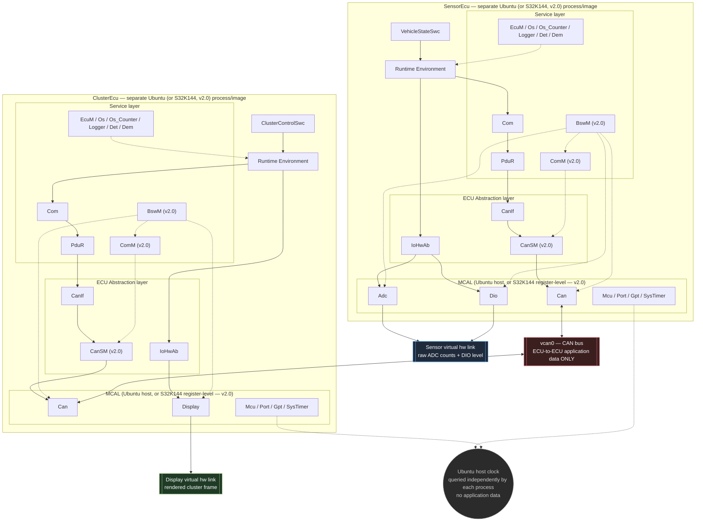
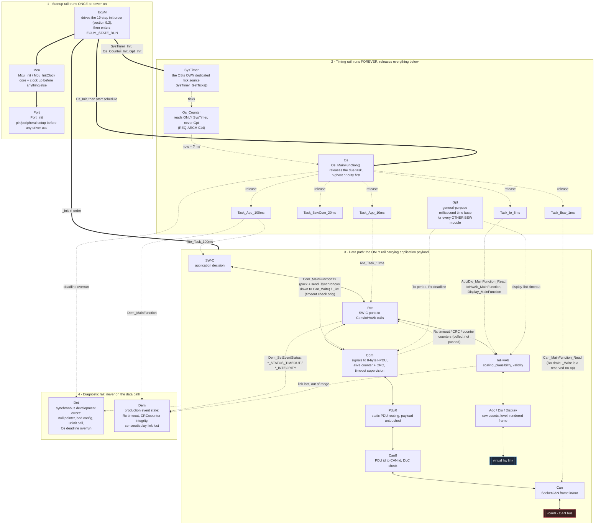
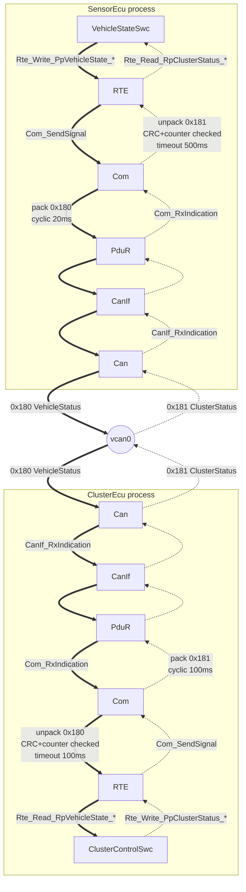

# Architecture

This document summarizes the architecture defined in
`AUTOSAR_CLASSIC_PROJECT_SPEC_v1.1.md`. It is a companion, not a
replacement — the specification is authoritative; this file is updated as
each implementation phase (section 16 of the spec) lands so it stays true
to the actual code rather than only the plan.

## Layers and vertical paths

`sensor_ecu` and `cluster_ecu` are two separate Ubuntu processes, each
with its own address space, PID, and memory — never one shared box — so
the layer diagram is drawn as two subgraphs, one per ECU, matching that
fact directly instead of a caveat underneath a merged picture:



Both ECUs happen to link the identical `bsw_mcal`/`bsw_ecuab` library
source (same `IoHwAb.c`, same `Can.c`) — that is why the two subgraphs
look structurally identical — but each ECU's static configuration
(`IoHwAb_ConfigSensor` vs. `IoHwAb_ConfigCluster`) determines which leaf
nodes it actually populates: `SensorEcu` never has a `Display` node
reachable, `ClusterEcu` never has `Adc`/`Dio` reachable. That is a real
build fact (each binary's `CMakeLists.txt` target links the whole
library, so the unused half sits as dead code in the other role's
binary), not a simplification. The only channel shared between the two
processes is `vcan0`; `Sensor virtual hw link`, `Display virtual hw
link`, and the host clock are each reached by exactly one side.

Three separate destination nodes are drawn on purpose, not one merged
"host" box: `Can` reaches only `vcan0`, `Adc`/`Dio` reach only the sensor
line, `Display` reaches only the display line, and `Mcu`/`Port`/`Gpt`/
`SysTimer` touch the host clock/process but carry no application data. A
diagram that merged these into one box would invite the (wrong) reading
that sensor/display traffic and CAN traffic share a channel, which the
channel table below forbids.

Two vertical paths, both mandatory:

- **Communication path**: `SW-C -> RTE -> Com -> PduR -> CanIf -> CanSM -> Can -> vcan0`. (v2.0: `CanSM`, not `CanIf`, now drives `Can`'s controller mode, on `ComM`'s behalf — `CanIf`'s own PDU-level Tx/Rx calls into `Can` are unchanged; see spec section 9.4.)
- **I/O path**: `SW-C -> RTE -> IoHwAb -> Adc / Dio / Display -> virtual hardware link` (sensor line for `Adc`/`Dio`, display line for `Display` — never the same link)

`BswM`/`ComM` (v2.0) are also service-layer, shown with dashed arrows above:
`BswM` triggers the driver init/deinit action lists that `EcuM` used to
sequence directly (spec section 9.4), and arbitrates communication-mode
requests, which `ComM` forwards to `CanSM`.

The MCAL (`bsw/mcal/`) is the sole substitution boundary: every host-specific
artifact (sockets, file descriptors, `clock_gettime`, the CAN interface
name) lives at or below it. Porting to a real microcontroller means
rewriting `bsw/mcal/` and nothing else — see `REQ-ARCH-012`. As of v2.0
(Phase 9), this has been done once, for the NXP S32K144 (register-level
`Mcu`/`Port`/`Gpt`/`SysTimer`/`Adc`/`Dio`/`Can` under `bsw/mcal/*_S32K144.c`
and `platform/s32k144/`), with no change required outside `bsw/mcal/`.

Full layer ownership / allowed-dependency table: spec section 3.1.

### Data flow direction vs. call direction

The diagram above draws arrows as **call/dependency direction** ("layer X
is allowed to call layer Y"), matching spec section 3.1's "May call"
table. That is not the same thing as which way the bytes actually move —
`IOHWAB --> ADC` means "IoHwAb is allowed to call into Adc", not "data
flows from IoHwAb to Adc". For the sensor input path the two directions
are opposite: `Adc`/`Dio` are *called* from above but *read* their data
from below (the virtual hw link), then hand it back up the same call
chain via return values. Only the display output path happens to have
call direction and data direction pointing the same way.

The diagram below shows the actual data flow, split by ECU, byte-oriented
rather than call-oriented:

```mermaid
flowchart LR
    subgraph SENSOR_ECU["SensorEcu — input path"]
        direction LR
        SLINK[["Sensor virtual hw link\nraw ADC counts + DIO level"]]
        SADC["Adc"]
        SDIO["Dio"]
        SIOHWAB["IoHwAb"]
        SRTE["RTE"]
        SASW["VehicleStateSwc"]
        SCOM["Com"]
        SPDUR["PduR"]
        SCANIF["CanIf"]
        SCAN["Can"]
        SLINK --> SADC --> SIOHWAB
        SLINK --> SDIO --> SIOHWAB
        SIOHWAB --> SRTE --> SASW --> SCOM
        SCOM --> SPDUR --> SCANIF --> SCAN
    end

    CANBUS[["vcan0 — CAN bus"]]
    SCAN --> CANBUS

    subgraph CLUSTER_ECU["ClusterEcu — output path"]
        direction LR
        CCAN["Can"]
        CCANIF["CanIf"]
        CPDUR["PduR"]
        CCOM["Com"]
        CASW["ClusterControlSwc"]
        CIOHWAB["IoHwAb"]
        CDISP["Display"]
        DLINK[["Display virtual hw link\nrendered cluster frame"]]
        CCAN --> CCANIF --> CPDUR --> CCOM --> CASW
        CASW --> CIOHWAB --> CDISP --> DLINK
    end
    CANBUS --> CCAN

    classDef sensorChan fill:#1f2a3b,stroke:#61afef,color:#fff
    classDef displayChan fill:#1f3b26,stroke:#98c379,color:#fff
    classDef canChan fill:#3b1f1f,stroke:#e06c75,color:#fff
    class SLINK sensorChan
    class DLINK displayChan
    class CANBUS canChan
```



(RTE is omitted on the ClusterEcu side above for brevity, but the real
call chain still runs `CCOM -> RTE -> CASW -> RTE -> CIOHWAB`, same as the
SensorEcu side — RTE always mediates SW-C access, it just doesn't change
which way the bytes flow.)

## Who participates in one transmit/receive cycle

The two diagrams above only show modules that touch the payload. Most of
the BSW never touches a payload byte yet is still required for a single
transmit/receive cycle to happen at all. This diagram separates the four
roles: startup, timing, data, and diagnostics.



Line styles: thick `==>` is one-shot initialization, solid `<-->` is
application payload moving in both directions, dotted is a call that
carries no payload (a periodic release, a time query, an error report).

| Module | Contribution to one tx/rx cycle | Payload? |
|---|---|---|
| `Mcu` | Brings up core and clock at startup so a time base can exist at all. Nothing during the cycle. | No |
| `Port` | Configures pins/peripherals before any driver uses them. Nothing during the cycle. | No |
| `SysTimer` | The OS's own dedicated tick source, read by nothing except `Os_Counter` (`REQ-ARCH-014`) — a real ECU gives the OS a hardware timer no other module shares, for exactly this reason. | No |
| `Os_Counter` | Converts `SysTimer` ticks to milliseconds for `Os`. Never calls `Gpt`; that separation is what a static check (grep for `Gpt_` under `bsw/os/`) proves mechanically. | No |
| `Gpt` | The monotonic ms source every OTHER periodic decision reads: `Com` ("is the 20 ms period up? has the Rx deadline passed?"), `IoHwAb` ("is this sample stale?"), `Display` (minimum write period), `Dem`/`Logger` (timestamps). Never read by `Os` itself. | No |
| `Os` | Actually calls every `_MainFunction`, timed by `Os_Counter`. Its fixed priority order at a shared release instant (Io 5 ms before App 10 ms before Com 20 ms) is what lets one sensor sample reach the bus within the same cycle instead of a period later. | No |
| `EcuM` | Runs the 19-step init order once so every module below is ready before the first task runs (`SysTimer`/`Os_Counter` before `Gpt`, both before diagnostics, before drivers, before the comm stack, before the RTE); reverse order on shutdown. A single wrong init step means the cycle never starts. | No |
| `Rte` | The only way a SW-C reaches anything: maps SW-C ports onto `Com_SendSignal`/`Com_ReceiveSignal` and `IoHwAb` calls. Carries payload but adds no logic of its own. | Yes |
| `Det` | Synchronous development-error sink. Never part of a healthy cycle: if `Det` fires, a caller violated a contract. | No |
| `Adc` `Dio` `IoHwAb` `Com` `PduR` `CanIf` `Can` `Display` | The data path itself, detailed in the two diagrams above. | Yes |
| `Dem` | Holds qualified fault state for events the cycle discovers (Rx timeout, CRC/counter failure, link lost, out-of-range). `Dem_MainFunction` in the 100 ms task ages and qualifies them; the SW-C reads the resulting state, it does not read `Dem` directly. `Com` itself never calls `Dem` (it only reports to `Det`); the four COM-related events are set by the RTE, which polls `Com`'s error counters each 10 ms — in real AUTOSAR the same job belongs to the SW-C/E2E layer via a Dem service port, so this is a documented simplification. | No |

The practical reading: a payload byte only ever moves through rail 3, but
it moves only because rail 2 released the task, and only because rail 1
had already made every module ready. Rails 1, 2 and 4 are what make the
data path *deterministic and observable* rather than merely functional.

## EcuM initialization order — rationale

`EcuM_Init` follows a fixed order (spec section 9.2, v1.2 — revised by the
SysTimer/Os_Counter split, see the change log in section 0.3):

1. Logger
2. `Mcu_Init`, `Mcu_InitClock`
3. `Port_Init`
4. `SysTimer_Init` + start the OS tick source
5. `Os_Counter_Init`, zeroed against that tick source
6. `Gpt_Init` + start the general-purpose time base
7. `Det_Init`
8. `Dem_Init`
9. Parse command-line (post-build-like) configuration
10. Input/output MCAL drivers (`Adc_Init`/`Dio_Init` or `Display_Init`)
11. `Can_Init`
12. `IoHwAb_Init`
13. `CanIf_Init`
14. `PduR_Init`
15. `Com_Init`
16. `Rte_Start`
17. CAN controller to `CAN_CS_STARTED`
18. Start COM I-PDU group (with init enabled)
19. Start OS schedule, enter `ECUM_STATE_RUN`

This is the standard AUTOSAR ordering rationale applied to this project:
**microcontroller and clock first** (nothing else can run without a time
base), **then pin configuration** (`Port`, so peripheral electrical setup
precedes any peripheral use), **then the OS's own time source** (`SysTimer`
before `Os_Counter`, both before the general-purpose `Gpt`, because the
scheduler must be able to keep time before any module `Gpt` serves even
exists — `REQ-ARCH-014`), **then diagnostics** (`Det`/`Dem` before any
other module, so every later initialization failure is recordable rather
than silently lost), **then drivers bottom-up** (MCAL, then `Can`), **then
the ECU Abstraction layer** (`IoHwAb`) which depends on those drivers being
ready, **then the communication stack bottom-up** (`CanIf` → `PduR` →
`Com`, each depending on the layer initialized just before it), and
**finally the RTE**, which is the first layer allowed to reach application
code. Shutdown (section 9.3) is the same order reversed (`Gpt_DeInit` →
`Os_Counter_DeInit` → `SysTimer_DeInit` last), so every module is torn
down only after everything that depends on it has already stopped.

Implemented in `bsw/services/EcuM/EcuM.c` (Phase 6) exactly as listed
above; verified live by running both ECUs and reading the printed
section 9.3 step-8 scheduler/DET summary at shutdown.

## Data flow between the two ECUs

The layer diagram above shows one ECU in isolation. This diagram shows both
ECUs together, walking the same layers in both directions at once:
`SensorEcu` transmitting `VehicleStatus` (`0x180`) while simultaneously
receiving `ClusterStatus` (`0x181`), and vice versa for `ClusterEcu`. Both
PDUs are equally real data paths — the thick/dotted line style below is
used **only** to tell the two PDUs apart at a glance; it does not mean
"mandatory vs. optional" the way it did in the layer diagram above.



Reading this diagram:

- **Thick arrows** (`==>`): the `0x180 VehicleStatus` path, `SensorEcu` → `ClusterEcu`, produced every 20 ms, with a 100 ms reception deadline monitored on the `ClusterEcu` side.
- **Dotted arrows** (`-.->`): the `0x181 ClusterStatus` path, `ClusterEcu` → `SensorEcu`, produced every 100 ms, with a 500 ms reception deadline monitored on the `SensorEcu` side.
- Every box is used by **both** flows — `Com`, `PduR`, `CanIf`, and `Can` each run one Tx pipeline for the local ECU's own PDU and one Rx pipeline for the remote ECU's PDU, per the static routes in spec section 7.5. There are not two separate copies of these modules.
- `vcan0` is the only thing the two processes share. Nothing here bypasses it — the receiving `Com` only accepts a frame after `CanIf`/`PduR` hand it a fully-formed I-PDU, and only after CRC + alive-counter validation does the RTE buffer update (`REQ-COM-003`, `REQ-RTE-005`); a single invalid frame leaves the previous application values untouched.
- This diagram is the **Communication path** from the layer diagram above, drawn twice (once per direction) and joined at `vcan0`. It does not include the **I/O path** (sensor/display virtual links), which is internal to each ECU and never reaches the other ECU — see the layer diagram's channel-separation note.

## Beginner's guide to the diagram above (Vietnamese)

The following explains the same "Data flow between the two ECUs" diagram
using a plain-language analogy, for a reader new to AUTOSAR who wants the
mental model before the module names. Kept in Vietnamese intentionally —
it's written for a Vietnamese-speaking newcomer, not as a spec-level
document, so it doesn't follow the English-only convention of the rest of
this file.

### Sơ đồ này nói về việc gì? — dùng phép ví von "gửi thư"

Hãy tưởng tượng 2 ECU là **2 tòa nhà văn phòng**, mỗi tòa có nhiều **phòng
ban xếp chồng lên nhau** theo tầng, và giữa 2 tòa có **một con đường
chung duy nhất** để xe chở thư chạy qua lại — đó chính là `vcan0`.

Mỗi tòa nhà đều có đúng các phòng ban sau, xếp từ trên xuống:

```
Tầng trên cùng: Người viết/đọc thư     ← SW-C (VehicleStateSwc / ClusterControlSwc)
Tầng dưới: Trợ lý riêng                ← RTE
Tầng dưới nữa: Phòng đóng gói           ← Com
Tầng dưới nữa: Phòng phân loại          ← PduR
Tầng dưới nữa: Bưu cục                  ← CanIf
Tầng trệt: Bãi xe chở thư                ← Can
                     │
                  con đường chung        ← vcan0
```

### Đi từng bước một lượt thư "tốc độ xe" từ SensorEcu sang ClusterEcu

Giả sử cảm biến đo được xe đang chạy 120 km/h. Đây là hành trình lá thư
đi qua sơ đồ (nhánh **nét đậm** trong hình):

1. **`VehicleStateSwc`** (người viết thư, ở tòa SensorEcu): viết nội dung
   *"tốc độ = 12000"* (đơn vị 0.01 km/h). Người này **không hề biết** thư
   sẽ đi bằng phương tiện gì, địa chỉ ra sao — chỉ đưa cho trợ lý.
   → `Rte_Write_PpVehicleState_VehicleSpeedRaw(12000)`
2. **`RTE`** (trợ lý riêng): nhận nội dung, chuyển xuống phòng đóng gói
   theo đúng quy trình nội bộ đã định sẵn.
   → gọi `Com_SendSignal`
3. **`Com`** (phòng đóng gói): gom nội dung này + trạng thái ignition +
   một **số thứ tự tăng dần** (alive counter) + một **con tem chống giả
   mạo** (CRC8) vào đúng 1 phong bì 8 byte, cứ **20ms lại gói và gửi một
   lần** dù nội dung có đổi hay không.
   → đóng gói thành I-PDU `VehicleStatus`
4. **`PduR`** (phòng phân loại): nhìn vào bảng đã treo sẵn trên tường
   ("PDU này → gửi ra bưu cục theo route số 0"), **không đọc nội dung
   thư**, chỉ chuyển tiếp theo địa chỉ đã cấu hình sẵn.
5. **`CanIf`** (bưu cục): dịch "tên gọi nội bộ của thư" thành **địa chỉ
   thật trên đường** — ở đây là mã CAN ID `0x180`.
6. **`Can`** (bãi xe): bỏ thư lên xe, chạy ra con đường chung `vcan0`.
7. **Xe chạy trên `vcan0`** — đây là khoảnh khắc duy nhất lá thư rời khỏi
   tòa nhà SensorEcu.
8. Bên tòa **ClusterEcu**, `Can` của họ đứng ở bãi xe **luôn để ý xem có
   xe nào từ đường chạy vào không** (không chặn tiến trình khác —
   non-blocking).
9. **`CanIf`** bên ClusterEcu nhận thư, thấy CAN ID `0x180` → tra bảng
   biết đây là PDU nào.
10. **`PduR`** chuyển thư này tới đúng phòng `Com` phụ trách.
11. **`Com`** bên ClusterEcu **xé phong bì**: kiểm tra tem chống giả mạo
    (CRC) trước, rồi kiểm tra số thứ tự có đúng "số liền trước + 1"
    không. **Nếu 1 trong 2 cái sai → vứt cả lá thư, không cập nhật gì
    hết** — đây chính là ý nghĩa dòng chữ "CRC+counter checked" trong sơ
    đồ.
12. Nếu thư hợp lệ, `Com` mới đưa nội dung cho `RTE`, và `RTE` mới đưa
    cho **`ClusterControlSwc`** (người đọc thư) — người này đọc được
    *"tốc độ = 12000"* và tự quyết định: 120 km/h > ngưỡng 100 km/h →
    chuyển trạng thái sang **OVERSPEED**.

### Vậy còn nhánh nét chấm là gì?

Đó là **lá thư đi chiều ngược lại**: `ClusterControlSwc` viết trạng thái
cụm đồng hồ (OFF/NORMAL/OVERSPEED...) rồi gửi ngược về cho `SensorEcu`
biết, qua đúng các phòng ban y hệt nhưng **đi ngược chiều**, đóng gói
thành CAN ID khác (`0x181`), chu kỳ gửi thưa hơn (100ms thay vì 20ms).

Điều thú vị: **cùng một phòng `Com`, một phòng `PduR`, một bưu cục
`CanIf`, một bãi xe `Can`** — nhưng vừa xử lý thư gửi đi (`0x181`) vừa xử
lý thư nhận vào (`0x180`). Không phải 2 bộ phòng ban riêng biệt cho 2
chiều. Đó là lý do trong sơ đồ, mỗi ô hình chữ nhật có **cả mũi tên nét
đậm lẫn nét chấm đi qua nó**.

### Vì sao phải qua nhiều phòng ban rắc rối vậy, gửi thẳng có được không?

Vì nếu `VehicleStateSwc` tự mình biết CAN ID là `0x180`, tự đóng gói
byte, tự gọi socket — thì khi thay đổi loại xe (đổi CAN ID) hoặc đổi hẳn
sang chip vi điều khiển thật, ta phải **sửa lại code người viết thư**.
Nhưng với cách chia phòng ban này, người viết thư **không bao giờ phải
đổi** — chỉ có "bưu cục" (`CanIf`) hay "bãi xe" (`Can`) cần đổi khi đổi
phần cứng. Đây chính là lý do AUTOSAR chia lớp: **mỗi lỗi/thay đổi chỉ
ảnh hưởng đúng 1 tầng**, không lan ra toàn bộ tòa nhà.

### Timeout (deadline) nghĩa là gì trong ví dụ này?

Nếu quá **100ms mà SensorEcu không thấy có thư mới nào từ ClusterEcu bay
tới** (bình thường 100ms có 1 thư), `SensorEcu` sẽ nghĩ *"chắc đường dây
bị đứt hoặc tòa bên kia sập"* → tự báo lỗi
(`DEM_EVENT_CLUSTER_STATUS_TIMEOUT`). Tương tự chiều ngược lại, nếu
ClusterEcu quá 100ms không nhận được `0x180`, nó sẽ chuyển sang trạng
thái `COMM_FAULT` (mất liên lạc) — thay vì cứ hiển thị mãi tốc độ cũ như
không có chuyện gì xảy ra, điều đó rất nguy hiểm trên xe thật.

Tóm gọn 1 câu: **sơ đồ này là 2 tòa nhà giống hệt nhau, đứng quay lưng
vào nhau, chia sẻ đúng 1 con đường ở tầng trệt, và mỗi tòa vừa gửi thư đi
vừa nhận thư về qua đúng các phòng ban đó — không ai trong tòa nhà biết
"con đường" trông ra sao, trừ đúng phòng `Can` ở tầng trệt.**

## Implementation status

See `docs/IMPLEMENTATION_STATUS.md` for the full phase-by-phase record.
**All 8 phases of the v1 spec's section 16 plan are complete** (plus the
between-4-and-5 SysTimer/Os_Counter split): both ECU executables run their
full lifecycle over real `vcan0`, every section 14.1 unit test and all
seven section 14.2 integration tests (IT-01 through IT-07) pass, the
project builds and passes its full test suite under AddressSanitizer and
UndefinedBehaviorSanitizer with zero diagnostics, and the `REQ-ARCH-012`
stub-MCAL build is verified. The layering, routing, and lifecycle
behavior described above is therefore the *observed* behavior of the v1
code, not only its target. `docs/REQUIREMENTS_TRACEABILITY.md` covers
every `REQ-*` requirement in the v1 specification.

**Phase 9 (v2.0 — `BswM`/`ComM`/`CanSM` and the S32K144 hardware port) is
in progress, not done.** The modules, MCAL drivers, and diagrams above
describe the v2.0 *target* architecture; the code does not yet fully match
it. `docs/IMPLEMENTATION_STATUS.md`'s Phase 9 section and
`docs/REQUIREMENTS_TRACEABILITY.md`'s Phase 9 section list the specific
open violations (in short: `BswM`'s shutdown action list leaks drivers,
`BswM_DeInit` skips cleanup after a failed init, `EcuM` can claim
`ECUM_STATE_RUN` before `BswM_Init` succeeds, `Os.c` reaches into `BswM`
directly, the S32K144 CMake variant still builds the POSIX-only unit
tests, and `ComM_ModeType` is defined twice). Treat the dashed
`BswM`/`ComM`/`CanSM` arrows above as the intended contract, not yet a
verified one.

An HTML rendering of this document, with the diagrams pre-wired to render
in a browser, lives next to it at `docs/ARCHITECTURE.html`.
